# HML ConstructSync — Current Application Context

> **Living document:** This is the canonical, implementation-aligned context for the application. Update this file in the same change whenever a major implementation changes the product scope, business workflow, domain model, permissions, routes, persistence, seeded walkthrough, architecture, or verification strategy. Do not record small visual polish, copy edits, or isolated bug fixes unless they change one of those areas.

**Last verified:** 2026-10-14
**Application version:** Prototype (`package.json` 0.1.0)
**State schema:** `DemoSnapshot` version 12

## Product in one paragraph

HML ConstructSync is a browser-local construction operations prototype, also deployed on Vercel for one-presenter company demonstrations. It demonstrates the linked journey from a Material Request Form (MRF) through Project Manager review, supplier quotations and comparisons, Purchase Order (PO) preparation, Accounting approval, Procurement issuance, external full-payment verification and delivery clearance, Logistics delivery, and site receiving/usage. A fresh workspace starts empty. It uses simulated roles, browser `localStorage` for records, and IndexedDB for uploaded MRF, supplier quotation and Accounting evidence files. On MRF approval, server routes archive a generated MRF PDF and its supporting PDF to a mapped Google Drive project folder. Finalized supplier quotations and Accounting-approved POs also archive to Drive. The server can parse quotations with Gemini when configured. Department email/password sign-in simulates access in the presenter browser; it has no server-enforced account authentication, shared record database, supplier portal or payment integration.

## Current product boundary

- Seven simulated roles share one workspace: Site Personnel, Project Manager, Procurement, Finance, Logistics, Accounting / Auditing, and Administrator.
- Seven bootstrap department accounts initialize the locally managed user directory with distinct passwords and Gmail-format identifiers without mailbox ownership or email delivery. Each account has a fictional display name, shown with department and personal initials in the header and account menu. Sign-in shows no account list, autofill or credential hints and requires valid credentials. On workspace routes, the account menu displays the current email/department, **Switch department** and Sign out. Switching selects an active named account without another password, changes permissions and new audit attribution together, and preserves the current route, project context and saved records. Auth routes have no switcher. Historical actors remain unchanged; started operations retain their initiating identity. Sessions remain until sign-out or account revision changes, while all accounts share the same browser-local records. These client-side checks simulate authorization rather than securing server APIs; Vercel deployment protection remains required.
- Project Manager reviews new MRFs and corrections across all projects without project assignments. Existing MRFs keep Procurement review. The generic MRF Approved by signature remains separate document metadata.
- Site filtering changes dashboard and queue context without creating separate tenant data.
- All operational changes pass through typed domain commands and update one linked snapshot. The active account supplies an immutable audit identity; started file pipelines retain their initiating identity and a scoped, version-bound acknowledgement runner after account changes. Current workspace role selection remains independent of that captured authority.
- The combined MRF support file is one required PDF of at most 50 MB, kept in the uploading browser's IndexedDB. It contains the hardcopy MRF, key plan, and work scope. Supplier quotation PDFs/images remain browser-local and receive Drive copies after finalization. Older MRF attachment references remain metadata for migration only.
- Drive credentials, the company root folder ID, and the upload-token key stay on the server. Administrator or Project Manager maps each project folder within that root. Vercel Drive routes require explicit enablement and Vercel Authentication for All Deployments, including production; simulated app roles do not secure them.
- Local origin checks use a validated loopback Host header when Next reconstructs a different listening hostname. Origin must match that Host with the server's protocol and port; absent Host retains the request-URL comparison. Forwarded headers cannot grant this exception, and Vercel continues to require the exact request-URL origin.
- Credential and project-folder setup is described in `docs/GOOGLE_DRIVE_SETUP.md`. The standard local dev and start scripts bind to loopback.
- The Gemini API key stays in the local Next.js server environment. Simulated roles do not secure the parsing endpoint; this integration is intended for local use only.
- For local parsing, copy `.env.example` to `.env.local`, set `GEMINI_API_KEY`, and restart `next dev`. MRF entry and quotation review both support manual entry without a key.
- External actions such as releasing a PO and recording payment are demonstrations only.
- The primary experience is desktop, while delivery receiving and inventory actions are intended to remain usable on mobile widths.

## Core business flow

```mermaid
flowchart LR
  Site[Site Personnel: MRF and attachments] --> PM[Project Manager: MRF approval and corrections]
  PM --> Procurement[Procurement: quotations, comparison, draft PO]
  Procurement --> Accounting[Accounting: PO review, taxes, charges, budget approval]
  Accounting --> Issued[Procurement: issue approved PO and mark Served]
  Issued --> Payment[External: Accounting - Finance - Accounting]
  Payment --> Verified[Accounting: archive proof and verify full payment]
  Verified --> Release[Accounting: separate delivery clearance]
  Accounting -->|Credit / terms: payment independent| Release
  Release --> Logistics[Logistics: schedule and dispatch]
  Logistics -->|Direct| SiteReceive[Site Personnel: receive and post stock]
  Logistics -->|Via company warehouse| CompanyWarehouse[Procurement: confirm warehouse receipt]
  CompanyWarehouse --> Forward[Logistics: schedule and dispatch onward batches]
  Forward --> SiteReceive
  SiteReceive --> Usage[Site Personnel: record usage]
```



For newly created MRFs, upfront purchases require Procurement supplier issuance and Accounting verification of full external payment against archived proof, followed by a separate delivery clearance. Existing MRFs/POs without a workflow marker keep the prior Procurement-review and in-app Finance flow; no historical issuance or payment is inferred. Credit purchases may proceed without a payment request or Finance decision. Approval, payment approval, disbursement, release, receiving, stock posting and document review have separate states.

## Roles and implemented responsibilities

| Role | Main implemented responsibilities |
| --- | --- |
| Site Personnel | Read operational records on Administrator-assigned projects, including linked PO prices, payment summaries and documents, without project/scope budget positions. Review destination stock suitability, confirm source stock releases and destination transfer receiving/posting; create/save/submit MRFs with one support PDF; revise returned or reopened requests; confirm receiving; post accepted stock; record usage and stock adjustments. |
| Project Manager | Review/return/reject new MRFs and all corrections; approval starts the MRF archive. Reviews all projects without manager assignments. Adds/edits projects, budgets, scopes and Drive settings through Projects, and views Reports and exceptions. |
| Procurement | Select matching stock across projects by MRF material, verify it and request source release; complete existing suitability reviews without creating new ones through the stock screen. Purchase only demand not held by transfers, orders, awards or existing suitability reviews. Review/return/reject existing MRFs and corrections, retry approved MRF archives, review/archive quotations, generate comparisons and submit POs; confirm supplier issuance for revised upfront purchases; confirm company warehouse receipt. |
| Finance | Process revised upfront and external-credit payments outside the app. For existing Finance-managed POs, prioritize and approve/hold/return/reject payment requests; separately record actual disbursements for approved requests. Returns go to Accounting. |
| Logistics | Schedule and dispatch source-approved site transfers without a PO/payment gate. Schedule and dispatch supplier/site or supplier/warehouse batches; forward confirmed warehouse quantities in multiple batches to their original PO/site. |
| Accounting / Auditing | Review PO finances and payment arrangement, approve within budget or return to Procurement, archive approved POs, attach/archive PO-level payment proof and verify full external payment for revised upfront POs; verify partial/full external-credit payments with proof and a due date; prepare payment requests for existing Finance-managed POs and release eligible POs to Logistics. Review delivery evidence separately; make justified stock adjustments. |
| Administrator | Manage named users, Site Personnel project assignments, access status and password resets; view Reports and exceptions; add/edit projects, maintain scope allocations and remove unused scopes, confirm and save validated Drive mappings, inspect filtered activity, retry archives, and reset browser workspace data through the Administrator maintenance page. |

The domain command layer in `src/domain/commands.ts` is the authority for permissions and transition validation. Hiding an action in the UI is not sufficient authorization.

## MRF sourcing from other project sites

The first procurement step on `/requests/[id]/quotes` is **Check site stock**. Procurement expands requested materials to choose stock across projects in the same normalized unit, enters quantities manually and reviews all choices together. Identical descriptions require Procurement verification; different or uncertain stock goes to destination-assigned Site Personnel with an explanation. Atomic submission creates source-release requests grouped by project and separate suitability reviews. Reviews hold demand only, allow partial approval/rejection and return approved choices to Procurement for explicit release after rechecking availability. Source-release proposals reserve stock and requested quantities; existing supplier awards, POs and active suitability reviews share the demand limit. Source-assigned Site Personnel approve full or reduced release or reject. Logistics schedules multiple trips and records dispatch, which debits source inventory once. Destination-assigned Site Personnel record accepted quantities and separately post destination stock once. Missing/damaged quantities reopen sourcing without restoring source stock. Procurement can cancel only undispatched allocation with a reason; individual trip cancellation preserves the approved allocation for rescheduling.

Transfers use destination-project TRF references and separately numbered DEL trips. No financial value, budget charge, supplier invoice or payment approval is attached. Generated versioned receipts and uploaded signed/supporting evidence archive under the destination MRF in Drive; failures retain the business record and permit retries. Accounting reviews transfer documents separately from purchase orders. Queues, inventory reservations, material coverage and audit links include both project endpoints. New revision-5 comparison PDFs/XLSX files freeze quantities remaining to buy and a requested/transfer/ordered breakdown; earlier frozen revisions keep their rendering basis.

Administrator user management assigns Site Personnel to projects. Existing accounts start with no assignments and receive setup guidance. Assignments restrict both operational reads and site actions, including MRF editing, receiving, posting, inventory writes and archive-operation startup. Lists, counts, searches, notifications, record links and documents follow the same read policy. Transfers involving either assigned endpoint expose the other project's transfer context and receipts without granting general project, MRF or inventory access. Other department permissions remain unchanged. Assignment changes revise sessions. Stock transfers and trips are optional additive arrays in the existing v12 snapshot, preserving older workspace records.

Site Personnel navigation contains Dashboard, Projects, Material requests, Deliveries and Inventory. Assigned-project PO details remain available through linked records, with transaction prices, payment summaries and read-only paperwork. Supplier/PO registers, PO editing, quotation comparisons, Finance, Accounting, Reports and Administration are unavailable through navigation and direct URLs. Project/scope allocations, commitments, aggregate spending, remaining funds and utilization percentages are hidden; scope names and amount-free funding validation remain available. Generic Drive browsing and folder links are hidden, while record-linked files remain as uploaded without automatic redaction. This is prototype presentation control: full records remain in browser storage, and server routes still lack account authorization.

For Site Personnel, All assigned projects uses only valid assignments; a stale unassigned project filter falls back to that view without rewriting the saved filter. New MRFs start with an assigned project, and accounts without assignments see setup guidance and empty operational lists. Account/revision changes remount workspace screens, closing dialogs and cancelling stale reads before inaccessible content can return. Archive jobs retain their initiating operation and ownership; status is shown only for readable records while background work continues.

This remains a single-browser prototype: it provides command validation and local reservation consistency, not shared cross-user transactional locking. Production rollout requires authenticated server authorization, database transactions/locking, authoritative stock ledgers and idempotent external workers. See `docs/adr/0003-mixed-mrf-stock-fulfillment.md`.

## Workflow states and invariants

### Material requests

- States: `draft`, `submitted`, `returned`, `approved`, `rejected`.
- New MRFs, draft edits, returns, and full corrections use three steps: Request details, Materials, and Review & submit. Next validates the current step; Back and review Edit links retain entered values and files. The final step accepts the supporting PDF and shows a request summary before submission confirmation. Save draft permits incomplete information from every step and opens the saved record. Step progress is temporary; refresh restores explicitly saved work. PDF-only corrections open on the final step with request details read-only.
- Only Site Personnel can create/edit drafts, returned requests, or Procurement-reopened corrections. A reopened request with linked quotations or POs permits only a support-PDF change; an earlier reopened request permits full editing.
- New requests offer optional AI import in Step 1 through `POST /api/requests/extract`, using the server's existing `GEMINI_API_KEY` and `GEMINI_MODEL`. Import accepts one multipage PDF or up to 12 ordered JPG/PNG/WebP page photos of one MRF, up to 4 MiB total. Users preview/reorder sources, explicitly extract and apply results, and confirm replacement of edited form values. The project remains a manual selection; unreadable fields remain blank with warnings. Multiple MRFs and unrelated documents are rejected. Cancellation, timeout and errors preserve the entered form and allow manual entry.
- AI source bytes and Blob previews stay temporary in browser memory and are sent to Gemini only for extraction. They are never cached as attachments or archived to Drive. The combined supporting PDF remains a separate required upload in Step 3. AI-filled forms stay editable and require a fresh review checkbox before submission; detail/material edits clear confirmation. Drafts retain optional `aiAssisted` metadata but no review acknowledgement. Submission records `aiReviewedAt` and `aiReviewedBy`; the command layer enforces review for resumed AI drafts too. Existing MRFs remain manual and schema 12 stays compatible. This acknowledgement does not replace MRF approval.
- Submission requires request details, at least one valid item, and one combined supporting PDF. The browser validates PDF type, signature, and 50 MB limit before storing it locally.
- Step 1 requires a manually chosen scope of work belonging to the selected project. Changing projects or applying an AI import clears the scope selection. Drafts may remain unassigned. Submission and initial/full-correction MRF approval require positive remaining scope funds; requests do not reserve money. Document-only corrections retain their scope and can proceed after existing POs consume the allocation.
- General request information includes a manually entered, globally unique M.R.F No. and editable Request Date, plus Requested by, Approved by, Purchaser/Procurement Officer, and Finance Officer names. All six fields are required for submission but may be blank in a draft. Request Date is document metadata and may be in the future; system timestamps still drive activity and report filters.
- Each material carries its own date needed, purpose, delivery location, and remarks. Submission requires a name, unit, positive quantity, date, and location; purpose and remarks may be blank. Register and project summaries show the earliest material date.
- A submitted MRF or submitted correction can be reviewed by Procurement. MRF approval requires a mapped project Drive folder. An insufficient PDF is returned to Site Personnel for replacement.
- Requested materials are listed as a table of material, quantity, date needed and delivery location, with optional purpose under the name. The request form adds an Edit and Remove action per row; the request detail page adds View and, where offers exist, Offers. Site stock by exact material name and unit is a column on the request detail page. Approval does not reserve or deduct stock.
- Form sections collapse without losing entered values; required sections start open and validation reveals the relevant field. Selecting a material row, adding a material, or failing material validation opens that material's dialog with the affected field focused; no detail dialog is open on arrival, and closing one restores focus to its row. A material missing a required field is flagged in the table. Matching-offer links open the quotation comparison filtered by material ID.
- Return and rejection require a reason of at least five characters.
- MRF approval records an `archive.pending` state and attempts Drive upload. The generated MRF PDF and supporting PDF are stored in separate subfolders under `<project>/<MRF number>/`. Supporting PDFs are uploaded in 3 MiB resumable chunks to fit Vercel's request limit. A failed upload leaves the MRF approved but Procurement paused; Procurement or Administrator retries manually. Completed archives retain numbered file pairs across reapprovals.
- New MRF PDFs and print previews retain the supplied NUMMER ETT branding and Letter landscape grid, including sixteen material slots, instructions, a blue supporting-file link and four signatory blocks. Generated values are centered and uppercase; request-date styling and attachment filename/link formatting are preserved. Formatting does not change stored input. Optional job-title inputs and printed titles are removed; existing title metadata is retained for compatibility. Extra rows or long cells continue on additional pages. Drive reserves the supporting file ID before generating the form, then fills that same file through resumable upload.
- Procurement may reopen an archived approved MRF. New Procurement actions pause during correction and archive pending states. Earlier quotations/POs stay linked. Procurement continues only after archive completion.
- The MRF detail page has a **MRF lifecycle** section that starts collapsed. Expanding it shows independent request/purchasing/payment/delivery progress and the combined activity history together; closing it preserves loaded history without changing records. **Open full lifecycle** links using `#lifecycle` open the section automatically. It follows explicit quote, comparison, allocation, PO, payment and batch/evidence relationships; new events retain MRF ownership and saved references even when drafts/allocations are removed. It does not infer unrelated stock usage or introduce an overall completion state.
- Dashboard and project details share an automatic, readonly MRF lifecycle checklist with Review, Served, Payment, Logistics, Delivered and Stock posting columns. Served requires issued coverage for revised upfront and external-credit POs and released coverage for existing Finance-managed POs across every requested material; Delivered requires accepted site quantities across related active POs. Posting uses posted site batches, independently of current inventory usage. Warehouse receipt and rejected POs contribute no site fulfilment. Unawarded quantities remain partial even when every existing PO is received.
- Finance completion requires full approved material coverage and full actual payment of those POs. Finance work follows active submitted/held/approved payment requests; draft/returned requests stay with Accounting. Upfront payments may finish before release and credit delivery may finish before payment. Holds/returns remain attributed to the affected records without changing the MRF review status.
- Checklist rows open a details modal containing linked PO, delivery-leg and per-material coverage tables. Latest activity uses explicitly linked audit events, with unknown names/times shown as unrecorded. Search/progress filters and 10/25/50 pagination keep large views manageable. Dashboard project filtering follows the global context; project detail always uses its route project. Expansion/filtering changes no workflow records.
- The dashboard retains role queues, key metrics and budget positions; its former status bars and single-PO teaser are replaced by the checklist. Project details retain budget scopes, stock and Drive documents while consolidating their separate record lists into the checklist.
- Audit events retain optional name/email/role snapshots, typed event kinds and changed-field labels. Quotation drafts, allocations, priorities and archive outcomes are logged alongside existing milestones. Unchanged automatic saves add no event. Historical roles and timestamps remain intact without invented names or completion times. Recorded timestamps display seconds in Philippine time. History is newest first, initially 50 rows/groups; consecutive same-actor quotation saves with gaps up to 60 seconds expand to the original events.
- Workflow handoffs and consequential decisions use a confirmation dialog; draft saves and routine edits do not. Action feedback uses one bottom-right notification stack rather than page banners: an operation that is running shows a sticky progress notification that is updated in place, and resolves to success (4 s), warning (8 s) or a sticky error. Field-level validation stays beside its input and never raises a notification; a command failure without a field does. Routine saves such as MRF drafts and quotation drafts add no notification. The Drive archive activity banner remains at the top of the workspace because it is a persistent multi-job status strip with per-file progress.
- Quotation review uses focused supplier sheets or an optional All quotations view. Offered materials use an editable worksheet with #, Material, Quantity, Unit, Unit price, Amount, Item match and Actions. Material combines the supplier description with the requested-item selector; AI confidence stays in Details. The worksheet keeps table rows at every width, a 900px minimum and at least 160px extra width for visible horizontal scrolling, sticky headers and a bounded 520px register. It defaults to 25 lines per page; pagination appears only when needed. Details and Delete remain alongside clickable rows, and Enter advances quantity/unit/unit-price editing down the filtered list, including across pages. Field errors and actual discrepancies receive emphasis; pending match confirmation alone stays neutral. Finalized/historical quotations and non-Procurement access remain read-only.

### Quotations and purchase orders

- Procurement uses three steps: Upload & review, Compare & award, and PO preparation. The comparative bid shows all materials as rows with grouped Unit price / Amount columns per current PHP supplier. Material/quantity/unit columns and headers stay fixed on desktop; mobile retains the horizontally scrolling table with the material column fixed. Native horizontal scrollbars remain visible where supported; an accessible synchronized range control appears on browsers using hidden overlay scrollbars. Search and All materials / Unassigned / Unsaved changes filters affect the view, not bulk award scope.
- Material prices apply item discounts and include VAT where applicable, normalized to the requested unit. Amounts use the full MRF quantity; actual awards use quantities remaining after existing orders. Quotation-wide adjustments and EWT remain separate. Lowest comparable eligible prices, including ties, are highlighted without choosing a supplier. Unknown VAT bases receive no normalized price or recommendation. Unquoted/short offers and incomplete supplier material subtotals are marked explicitly.
- Choose assigns the offered capacity up to the remaining purchase quantity and replaces other temporary choices for that material. Split quantity opens explicit per-offer quantities, retaining multiple alternatives and supplier splits. Award this supplier previews the entire MRF, replacing covered quantities and retaining other choices for gaps; cancellation changes nothing. Alternatives require a comparison-offer choice, shared with report generation and independent of awards.
- Review & save awards saves changed materials atomically through replaceMaterialAwardBatch. Saved awards persist; unsaved choices remain while the workspace is mounted and survive step/filter navigation. Discard changes restores saved awards. The review dialog groups suppliers, records optional supplier reasons and shows partial/fixed-discount estimate warnings. Create supplier PO drafts is a separate confirmed action available only after saving or discarding changes. Active supplier POs are linked and prevent additional awards; stale revision awards remain visible and removable through Split quantity. Partial purchasing and schema 12 remain supported.
- Comparison reports sit above Compare & award in a collapsed section whose contents remain mounted, preserving alternative choices. Reports remain independent of allocations and PO creation; generated draft creation opens PO preparation. The new command and UI preserve schema 12 and named audit ownership.

- Quotations begin as persistent drafts and may cover some MRF lines. They retain offered lines, discounts and charges, supplier details, commercial terms, source file IDs, and immutable finalized revisions. Older seeded quotations remain readable as legacy references without original file bytes.
- Supplier uploads use a bounded searchable/status-filtered queue with 10/25 groups per page and one selected-file panel. Each group accepts up to 12 ordered PDF/JPG/PNG/WebP files, 20 MB per file and 45 MB combined. Extract all ready groups processes eligible groups across every page/filter, with a per-group processing state. Header Enter manually creates a file-free draft; the selected group manual action includes its source files. Drafts must receive original supplier files before finalization. Quotation sheets are selected by supplier/reference/version tabs or search; source documents retain their multi-file preview dialog.
- Gemini proposes extracted data and MRF matches only. Procurement checks the original, corrects pricing and supplier details, confirms each match and unit conversion, and explains any remaining discrepancy before finalization. Manual entry needs no API key, but newly finalized quotations require supplier PDF/image originals and a completed Drive archive before award. Unfinalized drafts can be deleted; finalized quotations remain immutable.
- Finalized quotations can be compared without a fixed quote count. Procurement may record a supplier selection reason; awards are staged and persist until PO generation. Only PHP quotations are awardable.
- Focused quotation sheets show the source beside the worksheet at widths of 1280px and above (320px pane; 400px from 1600px). File selection, PDF pages/zoom, image zoom, Hide source and Expand source remain available. Ordinary field saves do not reload the preview. Smaller screens and All quotations mode use the existing View documents modal; missing source bytes leave material review usable. Secondary fields remain in Details and quote-level adjustments stay beneath the worksheet.
- Confirm item confirms the requested-material link only. Confirm eligible matches requires an explicit dialog and rechecks all quotation lines at confirmation, regardless of filters/pages, then saves eligible links together. Eligibility requires high confidence, a valid requested item, matching normalized units and quantities, conversion factor 1, no unresolved line issue and no printed/calculated amount difference. Partial quantities and uncertain/unit-difference matches require individual confirmation. Failed saves do not claim confirmation; skipped lines report their reasons. Pricing, VAT, finalization and award constraints remain unchanged.
- Draft edits save automatically, and issue navigation still reveals fields across the whole quotation. Delete draft remains a direct danger-outline button with confirmation. Revision, reanalysis and Drive archive actions retain their existing availability: one secondary action appears directly, multiple actions use More actions, and an empty action list renders nothing. The usual company workload is 1–20 materials and at most five quotations; these are design targets rather than enforced limits.
- Each PO stores its awarded MRF quantities and source quotation revision. Multiple POs may share one MRF; a material may be split across suppliers. Active PO and staged allocations cannot exceed requested MRF quantities or the supplier's quoted quantity; rejected POs release their allocation.
- Award generation creates one draft PO per supplier from the staged quantities. Procurement confirms each PO's line discounts and other charges. Draft and Accounting-returned POs may be edited; a draft using an older quote revision needs an explicit reason before finalizing. Submitted POs await Accounting; approved purchasing details are locked.
- Generated PO PDFs and print previews retain the supplied HML artwork and company header on Letter portrait pages. Vendor/bank/ship-to, reference and terms cells wrap and expand before material pagination; the complete linked MRF reference stays in its header field. The material grid keeps eleven rows when space permits, with measured row heights, VAT boxes and EWT/net totals. Ordinary shipping terms no longer generate a separate description-only form. Genuine long information or material overflow uses continuation pages. Editing screens retain their existing layout.
- New POs store per-order document fields: date, vendor address/contact/phone, bank and account details, ship-to details, requisitioner, payment terms, F.O.B. and shipping terms. Known quotation/project values prefill these fields. Date, vendor name, ship-to name/address, requisitioner and payment terms are required at finalization.
- New quotation drafts require confirmation of VAT / NON VAT, inclusive/exclusive prices and an editable VAT rate (default 12%). Comparison shows the reviewed treatment and whole-quotation financial estimates; finalized settings change through a quotation revision. New material comparison PDF/Excel projections apply item discounts and include VAT where applicable, while quotation-level adjustments and EWT remain separate.
- Quotation review retains compact supplier tabs, the quotation picker and One quotation / All quotations modes. Tab arrows appear only when overflow requires them. Supplier and quotation details starts collapsed on initial visits and reloads; expanding it shows all supplier, reference, date, payment, validity, availability, lead time, contact/address and additional terms fields together in one aligned grid. No nested More quotation details section remains. Supplier attachment management is inside View documents, including drafts with no files; finalized quotations remain view-only. The separate Supplier quotation documents section is removed. Issue navigation automatically opens the relevant section. Existing document controls, autosaving, Delete draft and archive/revision actions remain available.
- Below the unchanged Offered materials workspace, review places VAT treatment above editable adjustment rows in the left column, with a 360px computation card on the right from viewport width 1000px; smaller screens stack settings, adjustments and computations. VAT and quoted-price basis use native radios, with a small VAT-rate input. Wide settings panels arrange the controls side by side. NON-VAT hides basis/rate while retaining their values, and a VAT setting change clears review confirmation.
- The computation card keeps all materials, signed quotation adjustments, VAT, gross quotation total, estimated goods/services EWT and estimated supplier payable amounts visible. Longer calculation explanations are available under How this is calculated. It reconciles with existing pricing functions; extracted Tax adjustments are clearly marked as not separately added when financial settings apply. Non-taxable service flags remain intact. The explicit VAT review checkbox stays beside Finalize quotation beneath the summary, with the existing validation, confirmation and archive workflow. Legacy records retain their original total without inferred financial settings. Add supplier quotations and the accepted material/source workspace retain their existing layout.
- Generated POs inherit quotation VAT settings and calculate EWT from their actual material quantities and included services. Goods use material totals after line discounts; services use delivery and other service fees. For VAT-inclusive amounts, divide each taxable category by `1 + VAT rate / 100`, then apply 1% goods / 2% services. Exclusive and exempt amounts need no VAT division. Round each category deduction to cents. Separate general discounts reduce gross payable but do not reduce EWT bases. NON VAT has zero VAT and EWT. PO VAT replaces inherited source taxes; exclusive taxable inputs receive VAT once. Accounting alone can override each EWT category and restore calculated amounts; manual overrides survive later price and quantity edits. Finance, commitments, payment caps and payment status use net supplier payable. Existing records retain legacy calculations until explicitly reviewed; no reset is required.
- Draft printouts carry a preview watermark until Accounting approval. Previously archived PDFs remain unchanged.
- PO states: `draft`, `submitted`, `hold`, `returned`, `rejected`, `approved`, `released`.
- Procurement submits a PO to Accounting. While submitted or held, Accounting can directly edit the supplier, MRF materials, quantities, unit prices, discounts, charges, document fields, notes, payment arrangement and VAT/EWT. Material quantities remain within the MRF allowance and active supplier/PO uniqueness remains enforced. The original quotation stays unchanged; Accounting changes appear in activity. Return to Procurement remains available and preserves Accounting's direct edits. Approved/released POs remain locked.
- Accounting confirms `paymentMode` as `upfront` or `credit`. Approval validates reviewed finances, document essentials, confirmed adjustments and available project budget, then commits the unpaid PO value.
- Approved financial/purchasing details lock. Accounting archives the approved PO PDF and explicitly releases it to Logistics. Archive failures block release and offer retry.
- Revised upfront release requires supplier issuance, a verified fixed net payable after EWT with required payment date/method/reference and at least one archived payment-proof PDF/image, then a separate Accounting delivery-clearance confirmation. Proof limits are 12 files, 20 MB per file and 45 MB total. Proof is PO-level and independent of delivery batches. Verification retains actor, time and immutable proof snapshots; before clearance Accounting can reopen with a reason, preserving history and restoring unpaid commitment. After clearance it locks.
- Before supplier issuance Procurement can reopen an approved revised upfront PO with a reason for costing recheck. Prior approvals and archives remain in history, current approval/commitment/archive readiness reset, and revised costing requires fresh Accounting approval and a numbered PO PDF. Issued POs cannot reopen for direct edits.
- Existing upfront release requires full recorded Finance disbursement. Credit release needs no payment request, payment approval or disbursement.
- Revised upfront and external-credit POs enter Finance payment coordination after supplier issuance while unpaid; they remain excluded from legacy payment-request/disbursement commands. Their verification contributes to paid/spent projections without creating an in-app Finance payment.
- Payment requests for existing Finance-managed POs are PO-linked records with `draft`, `submitted`, `hold`, `returned`, `rejected`, `approved`, `disbursed` states. Accounting prepares drafts/resubmissions; Finance reviews submitted/held requests. Return goes to Accounting.
- At most one open request exists per PO; rejected and disbursed requests remain in history. Positive partial amounts are allowed up to the unpaid balance for both credit and upfront requests; preparation defaults to that balance.
- Finance records actual disbursement only against an approved request, for exactly its approved amount, with method/reference/date. Duplicate and excess payments are blocked. Approval alone changes no payment, budget spend or delivery state.

### Bid comparison reports

- Procurement generates versioned Excel and PDF comparisons in the Compare step, before PO creation. An approved/archived MRF, mapped project folder and finalized/archived PHP quotations are required. PO creation and approval are independent of comparison generation. Partial coverage is allowed.
- Each supplier contributes one latest finalized PHP quotation, including suppliers without awards. Drafts and non-PHP bids are excluded. When multiple offers match one MRF material, Procurement explicitly chooses one alternative for that supplier/material before generation; report selections do not change awards.
- New UNIT COST values use quotationLineAmount divided by offered quantity and confirmed conversion factor, retaining internal precision: item discounts applied and VAT added once only for VAT-exclusive taxable quotations. TOTAL COST is full required MRF quantity times that price, rounded to cents. MATERIAL SUBTOTAL sums material projections before quotation-level adjustments and EWT; incomplete totals are labeled. Missing prices remain blank. Reviewed valid VAT settings are required for new normalized reports. Fixed discounts are spread over offered quantities for comparison; partial PO awards retain their existing discount-confirmation safeguard.
- New Excel exports contain one continuous Bid comparison worksheet with all suppliers and materials, no supporting sheets and no frozen-pane dividers. Formulas reference only the worksheet's quantity/unit-price inputs and carry cached results matching PDF amounts. Long text continues within the same worksheet; printing may span pages. Every archived quotation source file has its own clickable link row. Excel edits do not update application records or saved versions.
- Each report freezes project, MRF, bid, PO inputs and selected alternatives. New reports set comparisonRevision 4 for normalized VAT-inclusive material prices and retain revision 3's company form without quotation-coverage rows/appendices. Revision 2/3 retain raw quoted-price arithmetic and their original layouts; reports without a comparison revision retain the original eleven-slot layout, actual-offered/effective pricing, supporting worksheets and legacy retry behavior. Snapshot schema 12 stays compatible. XLSX/PDF bytes remain in IndexedDB with separate SHA-256 identities and generation/archive statuses. Existing saved and pending versions remain unchanged; obtain new calculations through a new report version.
- Generation makes both downloads available and independently attempts their Drive archives beneath `<project>/<MRF number>/Bid Comparisons`. Dedicated encrypted tickets bind the artifact type; 3 MiB chunks support files up to 50 MB. A failure leaves the other artifact available and exposes a Procurement retry; retries reuse the report identity. All MRF viewers may download saved reports and open their Drive links, including after later corrections or Accounting returns.
- Workbook acknowledgements accept verified Google Drive or Google Sheets HTTPS links whose file ID matches the uploaded artifact. Archive jobs show global preparation, acknowledged upload progress, completion and persistent errors; retries reuse saved files and active jobs are deduplicated. Pending records after refresh offer retry without a running spinner.
- Missing local caches restore the exact archived bytes through a protected route validating project ancestry, artifact type and report tags. A hash mismatch is reported. Browser workspace clearing removes report records and cached bytes, while Drive copies remain.

### Budget

- Project Manager or Administrator creates and edits named scopes through project settings. Scope setup uses a dropdown with General Requirement, Structural Works, Civil Works, Architectural, Mechanical, Electrical, Plumbing & Sanitary, Fire Protection, Medical Gas and Variation Order. Existing custom names remain selectable when editing their allocations. Names are unique within a project; scope IDs and project ownership remain stable. Combined scope allocations cannot exceed the project allocation, and an allocation cannot fall below its committed plus spent amount. Every meaningful change records a named audit event.
- Project pages show scope allocations, commitments, spending and available amounts, plus the unallocated project portion, to departments other than Site Personnel. Site Personnel see scope names without budget figures. Project Manager and Administrator can edit allocations.
- Accounting PO approval checks both project and selected-scope availability using the existing net supplier payable, including Services. The domain command rechecks current balances at approval. Competing unpriced requests can proceed; subsequent POs are limited by the remaining scope funds.
- Materials and offered-material sections are Goods. Shipping and other non-material fees are Services; taxes and discounts remain financial adjustments. Extraction classifies service rows and moves them to adjustments without counting duplicate fees; draft review can move a material row to services while retaining its source values. Goods/services classification determines calculated EWT without changing stock or receiving quantities.
- The displayed provisional rule is `available = allocated - committed - spent`.
- Approved and released unpaid PO value is committed.
- A recorded payment moves that amount from commitment to spent, leaving available budget unchanged by the move itself.
- Draft, submitted, held, returned, and rejected POs are not commitments.
- This is prototype budget logic, not a formal accounting ledger.

### Administration

- Administration separates Projects and Activity into tabs. Add project opens a separate confirmed creation form, then opens the new project's settings modal on Drive folder. Compact project rows show location, budget, scope count and Drive linked/missing status. Project / Drive folder / Scopes tabs remember each project's last tab and retain unsaved inputs across closing, switching and searching. Closing or hiding folder settings cancels validation and ignores late results.
- Project Manager or Administrator edits project name, location and budget without changing IDs, mappings or linked records. The project cap cannot fall below scope allocations or committed/spent funds. Existing PO document fields and archived files remain unchanged.
- Only scopes unused by every MRF, including draft/returned/rejected requests, may be removed. Their allocations become unallocated within the unchanged project cap. Scope saves/removals and project saves require confirmation; cancellation leaves records and entered values intact.
- Drive mapping shows local Validating, confirmation of the validated folder/project, Saving, and Saved states. Failures remain beside the field and offer retry; duplicate clicks are blocked and outdated responses after disposal cannot save. Already-saved mappings add no audit event.
- Recent activity uses ten rows by default with 10/25/50 choices, record links, a details modal, and local search/project/department/From/To filters. Philippine date boundaries are inclusive and use actual audit timestamps. Filtering preserves original quotation-save grouping boundaries and includes only matching events; unknown times remain available without date filters.
- New audit entries retain optional project ownership, including deleted scopes. Legacy project associations follow explicit linked records; unassociated entries remain available in All projects and Workspace/unassigned. Original history is not rewritten.
- Workspace registers share compact toolbars, two-line row summaries, aligned numeric columns, bounded table bodies with fixed headers, and accessible 10/25/50 pagination. Search, sorting and project changes return to page one. Accounting pages count complete MRF groups; Deliveries uses separate Delivery batches / Ready to schedule tabs. Dashboard and report summaries remain overviews; editable comparison and allocation matrices stay unpaged.
- Desktop navigation is compact and never scrolls. All destinations appear when they fit; shorter windows keep role-primary destinations and expose the rest through More sections, marked active for a secondary route. Mobile retains a scrollable hamburger drawer. Account, department switching, project context, notifications and theme controls remain in the masthead.
- Project settings, activity details, supplier quotation history and checklist related records use native modals with fixed title/Close and a scrolling body; closing restores the triggering control or a visible fallback. Quotation secondary actions use a More actions popover; operational record links retain their routes.
- Workspace disclosures keep long expanded headings accessible below the measured workspace header/archive banner. MRF lifecycle always participates while expanded; nested headings do not stack. Material search follows its section heading. Horizontally clipped record headings use one accessible floating control, returning focus to the original toggle after collapse.
- The purchase order, Accounting record, Finance payment and delivery batch activity timelines are collapsed disclosures whose heading states the history row and recorded event counts. Expanding one shows a height-bounded table with a fixed header and 10/25/50 pagination; every row stays mounted, so expanded grouped saves and printing the complete history are unaffected. The MRF lifecycle combined history keeps its own 50-row progressive loading.

### Delivery and inventory

- Only released POs can have delivery batches.
- Delivery legs are Supplier → Site, Supplier → Company Warehouse, and Company Warehouse → Site. Logistics captures destination name/address at scheduling and separately records dispatch. The schedule defaults to the current Philippine calendar date. Onward legs inherit the parent warehouse origin and retain their PO/site relationship.
- Batch states: `expected` (scheduled), `dispatched` (in transit), `confirmed` (received), `posted` (site stock posted). Procurement confirms warehouse receipt; Site Personnel confirms direct/onward site receipt. New batches must be dispatched before receiving. Legacy batches without leg metadata keep their prior direct-site receiving flow.
- Supplier batches share the PO allowance. Warehouse receipt resolves the accepted supplier quantity; direct-site batches retain their expected reservation through stock review. Warehouse children reserve their parent receipt's accepted quantities at scheduling and consume them at dispatch. A forwarded shortage remains a discrepancy and does not restore warehouse allocation or create a supplier replacement allowance.
- Warehouse receiving increases no site stock. Warehouse-held quantities and quantities available to schedule are distinct; scheduled onward allocations remain physically held until dispatch. Site receipt alone drives PO site-delivery progress; posting creates inventory movements once. Fractional quantity balances remove arithmetic remnants without changing stored inputs.
- A shortage or damaged/rejected amount requires an issue note. Stock-posting corrections require a reason and stay within batch/source/PO limits; receipts show the correction reason.
- `/deliveries` uses a compact batch/leg table with source references, project/supplier, schedule, route, destination, stage and readonly payment arrangement plus actual Finance-recorded methods. Materials remain on detail/scheduling pages. Released POs with supplier capacity offer scheduling; warehouse details offer onward scheduling.
- Delivery receipts reuse the supplied PO company artwork/header, Arial fonts and blue grid. Preview/print/download is available before and after confirmation. Pending receipts identify unconfirmed actual quantities; received receipts show recorded receiver/time, accepted quantities and issues, with signature spaces and long-content continuation. Preview generation stays readonly and uncached. Receipt confirmation saves an immutable snapshot and automatically archives its generated PDF to Drive. Corrected accepted quantities at stock posting create a new version without replacing the original. Failed archives never undo confirmation or prevent stock posting; pending versions retry independently. Historical deliveries require explicit archive capture, not a bulk background upload.
- After confirmation or posting, Site Personnel captures signed site receipts and supporting evidence; Procurement captures signed warehouse receipts. Accounting may upload missing paperwork for any received batch or attach PO-level invoices and other documents before delivery. PDF/JPG/PNG/WebP uploads are limited to 20 MB each, 45 MB and 12 files per batch. File signatures and SHA-256 hashes are checked; metadata links every file to its PO and optional batch; signed receipts always link to a received batch and its current generated-receipt version. Uploading evidence does not post stock or record payment.
- Accepted quantity cannot exceed the expected batch quantity or open PO balance.
- Posting uses accepted quantity, creates site-specific receipt movements, and is allowed once per batch.
- Editing accepted quantities at posting time requires a reason.
- Inventory is calculated from movements per site and per normalized material/unit pair: opening + receipts - usage +/- adjustments.
- Usage cannot create negative stock. Usage and adjustments require a reason; Accounting is a backup role for adjustments.

### Accounting

- Document review states are `Incomplete`, `Under Review`, `Complete`, and `Discrepancy`.
- Completing review requires invoice and receipt references, all uploaded evidence archived, and an archived current generated receipt plus a separately uploaded/archived signed delivery receipt for every confirmed/posted batch across all three delivery legs. Accounting checks signatures and quantities manually. A discrepancy requires a note. These post-delivery rules do not gate earlier upfront payment verification or delivery clearance.
- Payment status is derived independently as Unpaid, Partly Paid, or Paid.
- Finance disbursements must match an approved payment request and stay within the unpaid PO amount. Invoice/receipt completion is not required for upfront payment.
- Accounting PO review is available for submitted/held POs. Payment preparation, release review and document review are available after PO approval.
- The queue groups all related POs by MRF, including drafts, returned and rejected records. Search and project filtering retain those groups; submitted/held POs offer Accounting review; draft/returned POs await Procurement.
- Accounting records have an optional `documents` array compatible with schema 12. Evidence is available on both delivery and Accounting details, with local previews, protected Drive restoration, archive status and retries. New evidence, new deliveries, receipt quantity corrections and evidence reclassification reopen Complete reviews as Under Review without changing financial entries. Prior reviews retain their references, notes, actor and timestamp. Accounting and Administrator retry archives; receiving teams retry their corresponding delivery evidence. Existing generic Delivery receipt attachments require explicit Accounting classification to count as signed evidence. The Accounting screen groups documents by delivery and PO, and links existing payment proofs without uploading duplicates.
- Evidence archives use `<project>/<MRF>/Accounting Documents/<PO>/<batch>`, with file identity, hash and relationship tags. Encrypted upload tickets bind batch/PO/document IDs and file limits. Downloads validate project ancestry and relationship tags; a missing local cache restores only bytes matching the saved hash.

## Architecture and sources of truth

| Area | Current implementation |
| --- | --- |
| Framework | Next.js 16.3.6 App Router, React 19.2.8, TypeScript 5. |
| Route layer | `app/`; route files are thin adapters that render feature components. Dynamic route `params` and `searchParams` are awaited. |
| Feature screens | `src/features/` grouped by requests, purchasing, Finance, deliveries, inventory, Accounting, projects, suppliers, reports, dashboard, and admin. |
| Shared shell/UI | `src/components/`; `AppShell` owns navigation, account/site controls, theme, notifications and shared workspace chrome. Visible screens, metadata and feedback use production-style wording; the underlying prototype boundary remains documented here. |
| State access | `DemoProvider` in `src/app-state/` exposes repository state, signed-in command execution, account sessions, sign-in/sign-out, signed-in department switching, reset and transient notices. Department switching selects a complete fixture identity; normal UI cannot execute the setRole command directly. |
| Domain model | `src/domain/types.ts` defines records and statuses. |
| Mutations | `src/domain/commands.ts` is the single transition, permission, and validation boundary. |
| Read visibility | `src/domain/read-access.ts` resolves active-account project/record ownership, operational routes, budget visibility and archive targets. The provider exposes one policy and an effective project filter; command validation and stock/financial calculations retain the full snapshot. |
| Derived data | `src/domain/pricing.ts` calculates quotation and PO totals; `src/domain/procurement.ts` validates quote review and revisions; `src/domain/selectors.ts` calculates budgets, delivery balances, payment state, and inventory. `src/domain/queues.ts` derives role tasks and dashboard metrics. |
| Persistence | `src/mock/repository.ts` owns local loading, saving, schema guards, recovery and explicit reset behavior. |
| Workspace baseline | `src/mock/fixtures/blank.ts` creates an empty browser workspace. `seed.ts` remains a test fixture only. |
| Styling | Global layers in `src/styles/` plus `app/globals.css`; `ui-direction.md` documents the visual direction. |
| Verification | Domain tests in `tests/demo.test.mjs` and `tests/procurement.test.mjs`; extraction tests in `tests/quote-extraction.test.mjs`; grouped quotation, award, Accounting approval and credit-release browser check in `scripts/quotation-smoke.mjs`; broader browser walkthrough in `scripts/browser-smoke.mjs`. |

Keep business rules out of page components where practical. New state transitions should be modeled as commands, new calculations as selectors, and durable records in the versioned snapshot.

### Loading presentation

- Startup uses neutral workspace or sign-in skeletons while browser records and account sessions initialize. Workspace route fallbacks use shared summary, register, detail, form and quotation layouts inside the loaded shell; navigation retains the sidebar and header. Skeletons reserve space immediately and become visible after a 150 ms grace period. Ready content appears immediately, including cached routes and synchronous local filtering/pagination.
- Drive listings and document previews use region-level skeletons. Same-context reads retain valid content; changed folders/searches hide prior results; pagination appends placeholders below existing rows. Aborted or outdated responses cannot replace the current selection. Empty, missing-file, error, user-directory recovery and workspace recovery states terminate loading explicitly.
- Generated PDF preview dialogs open before generation completes, retain Close, and offer Retry on generation failure. Closing cancels or ignores pending work and restores focus; Blob URLs are released. PDF skeletons remain until a visible page renders; galleries, image decoding, later PDF pages and thumbnails have their own placeholders.
- Placeholders use theme tokens and subtle shimmer, with static shapes for reduced motion. Each loading region exposes its busy state and one accessible status; shapes have no interactive controls. Upload/extraction/archive/action progress retains its existing feedback. These presentation changes add no commands, domain terms or stored fields.
- `node --experimental-strip-types scripts/skeleton-loading-smoke.mjs http://127.0.0.1:3000` checks controlled startup, every page family, Drive replacement/append/stale/error cases, immediate preview/cancellation/retry/rendering, persistent shell navigation, local filtering, missing/recovery states, responsive themes and reduced motion in an isolated browser. External responses are mocked. The existing document-gallery and broad workflow smoke scripts remain regressions.
- Verified on 2026-10-11: all 217 tests, lint, TypeScript and the production webpack build pass. Skeleton loading, document gallery, grouped Accounting register and full workflow browser smoke checks pass; Drive responses are mocked and no live company archives are created.

## Persistence and recovery

- Current storage key: `hml-constructsync-demo-v12`.
- On first load, the repository creates an empty workspace if no saved state exists.
- Account session key: `hml-constructsync-session-v2`, storing only email and derived role. The former `hml-constructsync-demo-session-v1` is discarded without touching workspace records, requiring one new sign-in. Malformed or unknown account identities require sign-in. Project Manager is available as a named account. Current v12 workspaces preserve their saved department selection and all historical actor labels; no existing MRF/PO workflow is changed. Obsolete assignment fields remain readable without assigning project access.
- Previous workflow records (v11 and earlier) require an explicit manual workspace clear. The app shows recovery and preserves saved records/keys until confirmation; it does not migrate old transactions into the new department flow. Pure legacy conversion helpers remain for historical regression tests and are not used by the active loader.
- MRF and quotation originals remain browser-local. Successful MRF archival also creates numbered Drive copies; clearing browser data removes local records/files but does not delete Drive files. The Gemini Files API is not used as permanent document storage.
- Malformed saved data enters an explicit recovery state instead of being silently overwritten.
- Additive audit and reviewer/uploader/payment/stock identities preserve schema 12. Session storage still contains only email and role. Scoped operations restrict target IDs, document versions and acknowledgement types; stale ordinary UI callbacks are rejected after account changes.
- Optional audit `projectId` metadata extends schema 12 without backfilling legacy events. Project editing and unused-scope removal preserve current IDs, historical records and document snapshots.
- Scope budgets add a `scopes` collection and optional MRF `scopeId` within schema 12. Saved v12 records without scopes load with an empty collection without storage writes, guessed assignments or historical changes. Unassigned records display explicitly; new submissions and PO approvals require a valid scope. Existing approved/released workflows remain operational. The presenter will manually clear the prior walkthrough before fresh scope setup.
- Optional batch routing, parent links, location snapshots and immutable scheduling/dispatch/receiving/posting identity metadata extend schema 12. Missing legacy routing means the existing direct-site flow; missing operation timestamps/names remain explicitly unrecorded. New routing metadata is validated on reload. Receipt archive versions, optional PO-level document association, signed-receipt version bindings and review history extend schema 12 without resetting existing records. Historical receipts are captured only through an explicit archive action; preview remains readonly.
- If storage is unavailable, the app continues with volatile in-tab state and displays a warning.
- Clear workspace restores the empty baseline, removes recognized legacy keys, and clears browser-local MRF and quotation files. Existing saved work remains until explicitly cleared.
- Old query-string links using `?view=&kind=&id=` redirect to current routes through `src/domain/legacy-links.ts`.

Any incompatible snapshot change requires a schema-version decision and a migration or an explicitly documented reset strategy.

## Route map

| Route | Purpose |
| --- | --- |
| `/` | Redirects legacy query links or defaults to `/dashboard`. |
| `/dashboard` | Role-specific metrics and derived task queue. |
| `/projects`, `/projects/[siteId]` | Project register and site workspace, including mapped Drive folder browsing and name search. |
| `/requests`, `/requests/new` | MRF register and creation. |
| `/requests/[id]`, `/requests/[id]/edit` | MRF detail/review, editable draft/return/correction form, Drive archive status, retry, and version links. |
| `/requests/[id]/quotes` | Guided grouped upload or manual quote entry, saved review and finalization, comparison, staged split awards, and PO generation. |
| `/suppliers` | Supplier directory derived from finalized quotations. |
| `/purchase-orders`, `/purchase-orders/[id]` | PO register and linked detail. |
| `/purchase-orders/[id]/edit` | Editable draft or returned PO. |
| `/finance`, `/finance/[poId]` | Finance external payment coordination, with a separate legacy payment request/disbursement tab. |
| `/deliveries`, `/deliveries/new` | Delivery tracker and batch scheduling. |
| `/deliveries/[id]` | Receiving confirmation and stock-posting flow. |
| `/inventory`, `/inventory/[siteId]/[materialId]` | Site inventory and material movement history. |
| `/accounting`, `/accounting/[poId]` | All POs grouped by MRF; PO/budget review, payment preparation, Logistics release and supporting documents. |
| `/reports` | Project Manager and Administrator cross-project reporting. |
| `/sign-in` | Email/password department access with no predefined account hints. |
| `/admin` | Project creation, Drive folder mapping and activity; no workspace reset control. |
| `/admin/maintenance` | Administrator-only confirmed workspace reset, linked from Administration. |
| `/api/drive/validate`, `/api/drive/archive`, `/api/drive/archive/chunk`, `/api/drive/files` | Protected project folder validation, resumable PDF archive, and project folder browsing/search. |
| `/api/documents/preview` | Generates the same MRF/PO PDFs used for archival for browser preview, download and printing. |
| `/api/bid-comparisons`, `/api/drive/bid-comparisons`, `/api/drive/bid-comparisons/chunk` | Server XLSX/PDF generation, protected report archival/download, and dedicated resumable uploads bound to artifact type. |
| `/api/drive/delivery-receipts` | Validates confirmed receipt snapshots and archives immutable, numbered generated PDFs. |
| `/api/drive/accounting-documents`, `/api/drive/accounting-documents/chunk` | Protected receipt/evidence archival, resumable upload/status, and verified downloads. |

All workspace routes are wrapped by `app/(workspace)/layout.tsx`, which applies the data gate and application shell.

## Empty workspace baseline

- A fresh browser starts with no projects, suppliers, MRFs, quotations, POs, deliveries, stock movements, payments, accounting records, or activity.
- Administrator adds a project with its name, location and allocated budget, then creates funded scope allocations. Site Personnel can select a scope and submit the first MRF.
- Suppliers enter the directory when Procurement finalizes a quotation.
- The historical cement transaction remains in `src/mock/fixtures/seed.ts` for automated test fixtures only. It is never loaded for a new or cleared workspace.

Department account credentials and reset instructions: [PRESENTER_ACCESS.md](PRESENTER_ACCESS.md). Architecture decision: [protected department walkthrough](adr/0001-protected-department-walkthrough.md).

## Verification baseline

Run the following after changes that affect behavior or architecture:

```bash
npm test
npm run lint
npx tsc --noEmit
npm run build
```

With the development server running, use `node scripts/browser-smoke.mjs` for the broader linked workflow, persistence, legacy links, and UI checks at 320–1440 px in light and dark themes. UI regressions cover short-screen sign-in scrolling, long request references, account-dialog focus containment and restoration, text/focus contrast, mobile control sizes, and document-preview bounds. Use `node scripts/quotation-smoke.mjs http://localhost:3100` with a production server on port 3100 for grouped quotation review, saved awards, split POs, Accounting approval and credit release, and print status.

Use `node scripts/register-smoke.mjs http://localhost:3100` for complete Accounting groups, page sizes/ranges/filter resets, fixed headers and visible footers, independent Delivery tab controls, responsive themes, modal focus and quotation action popovers. The broader walkthrough also checks short desktop navigation, the mobile drawer, retained project drafts/tabs and late folder-validation cancellation.

Use `node scripts/compare-allocate-smoke.mjs http://localhost:3100` for the comparative bid with 100 materials and five suppliers: normalized price ties, split quantities, whole-supplier gap retention and cancellation, review/save separation, persistence, stale award removal, explicit PO generation, fixed headers and visible horizontal controls on desktop/mobile in both themes.

The domain test suite currently protects these high-value behaviors:

- Seeded purchasing, delivery, inventory, and budget consistency.
- MRF permission/review rules and ID preservation after return/resubmission.
- Seven unique account passwords, normalized emails, invalid credential/session rejection, remembered sessions, password-free session storage and legacy session invalidation without record loss. Department switching requires an active session, updates the complete identity, preserves workspace records and historical attribution, and rejects stale commands from the previous account. Browser checks cover workspace switching, auth-page exclusion, remembered selection, sign-out/sign-in handoffs, product copy/metadata, and maintenance visibility/access.
- The browser walkthrough covers MRF step validation, navigation and file retention, incomplete draft saving/reopening, final confirmation, returned-request resubmission, PDF-only corrections, and responsive step layouts.
- MRF AI tests cover source limits/signatures, same-origin requests, ordered page uploads, malformed/unrelated/multiple-request results, provider failures, blank unreadable values and mandatory review metadata. The browser uses mocked extraction responses to verify preview, cancellation, retry, explicit replacement, manual editing, separate attachments and fresh review after draft reopening. Live OCR accuracy remains dependent on the configured model and document quality.
- Single stock posting, outstanding quantities, site isolation, and nonnegative inventory.
- Payment movement from commitment to spent without double-reducing available budget.
- Prior workflow reset guard, explicit clearing, current payment/release persistence and malformed-data recovery. Historical migration helper tests remain separate from active loading.
- Quote review/finalization, staged split award caps, charge confirmation, quote revisions, and version-4 migration.
- Legacy URL routing.
- Site Personnel read-policy tests cover record ownership, assigned-project metrics, transfer endpoint exceptions, direct routes, document targets and unchanged funding checks. `scripts/site-visibility-smoke.mjs` verifies hidden budgets with retained PO prices/documents, restricted navigation and URLs, empty assignments, responsive themes, account/revision changes, stale previews and archive-status filtering. The existing stock-transfer walkthrough verifies source approval, destination receiving, evidence archives and Accounting review under the same policy.
- The broad browser walkthrough accepts `--workflow-only` after its base URL to rerun purchasing, payment, receiving and recovery checks from a prepared approved MRF without repeating the earlier sign-in, layout and MRF-entry checks. Its normal run includes both portions. PDF viewer cleanup handles initialization cancellation during account changes; gallery and visibility checks exercise document rendering and stale-read disposal.
- Bid report readiness, immutable versions, v9 migration, workbook formulas and cached totals, quotation revisions, partial awards, and dedicated XLSX upload validation. The quotation browser walkthrough also verifies Drive failure/retry, exact cache recovery, report persistence, and Finance downloads.
- Comparison revision 2 protects raw converted unit prices, required-quantity projections, explicit alternatives, incomplete coverage, dynamic supplier counts, single-sheet formulas, complete long text, clickable quotation links, and legacy report dispatch. PDF regressions verify complete PO references, ordinary shipping terms on one page, MRF capitalization, attachment casing and preserved input. Browser verification exercises alternative selection before generation.

## Known assumptions and non-goals

- Main department handoffs follow the client-approved flow. Detailed departmental fields and policies will be supplied later.
- Actual supplier transfers take place outside the app. Revised full-disbursement verification is recorded by Accounting; credit approvals track proof-backed partial or full payments in Accounting, while existing Finance-managed records retain Finance-entered payment references.
- The budget commitment calculation is a display rule pending client validation.
- Formal purchase closure is not modeled.
- Process bypassing is deferred at the user's request. Current approval, archive, payment and quantity controls remain mandatory. Project monitoring derives the confirmed Served/Delivered definitions from current records and does not depend on a bypass feature. A single overall MRF closure rule remains outside the checklist.
- Formal tax/VAT/EWT accounting, accruals, bank balances, detailed ledgers, real notifications, shared record storage, email, and Drive quotation import are out of scope.
- The year embedded in generated PO references is currently fixed to `2026`.
- The repository is deliberately local-first and single-browser; concurrent multi-user behavior is not modeled.

## Maintenance contract

Update this file in the same implementation whenever a change affects any of the following:

1. Product scope, terminology, or a working assumption.
2. A role, permission, handoff, status, validation rule, or business invariant.
3. A domain record, command, selector, snapshot version, storage key, or migration.
4. A user-facing route, major feature area, or architectural ownership boundary.
5. Seeded records or the canonical walkthrough and its expected figures.
6. Required verification commands or protected end-to-end behavior.

When updating it:

- Describe the implemented behavior in present tense; keep future plans in **Known assumptions and non-goals**.
- Reconcile related sections rather than appending contradictory notes.
- Update **Last verified** and add one concise entry to the change log.
- Confirm statements against the implementation, especially `types.ts`, `commands.ts`, `selectors.ts`, the repository, route files, and tests.
- Keep detailed design history in version control; this file should remain a compact snapshot of the current system.

## Context change log

| Date | Context change |
| --- | --- |
| 2026-10-14 | Restricted Site Personnel to assigned-project operational records, hid project/scope budgets and department workspaces, retained linked PO prices/documents and cross-project transfer context, and scoped navigation, direct URLs, archive activity and account-change cleanup through a shared read policy. |
| 2026-10-11 | Added app-wide skeletons for startup, route families, Drive listings and document loading with a 150 ms grace, reduced motion and retained shell/content. Generated preview dialogs open immediately with cancellable loading and Retry; stale reads and terminal recovery/error states are handled explicitly. |
| 2026-10-10 | Replaced the single success toast with a bottom-right notification stack covering action feedback: sticky in-place progress, success at 4 s, warning at 8 s, sticky errors, and field-level validation left inline. Adding a project reports each stage from saving through Google Drive folder setup. The archive activity banner stays at the top of the workspace and gains a state-coloured rail and activity count. |
| 2026-10-09 | Restored Project Manager review for new MRFs and all corrections; added Procurement supplier issuance/Served, archived PO-level payment proof, fixed net external-payment verification, separate Accounting delivery clearance, controlled pre-issuance costing rechecks and verification history. Existing and credit payment flows retain their records and Finance actions. |
| 2026-10-08 | Added confirmed quotation VAT / NON VAT settings, inherited PO treatment, calculated goods/services EWT, Accounting category overrides and direct PO edits before approval. Preserved source quotations, legacy totals and returned PO edits; verified the company sample, 163 automated tests, both browser walkthroughs, desktop/mobile financial layouts and lint/type/build checks. Dropped MRF-level VAT planning. |
| 2026-10-08 | Made the purchase order, Accounting record, Finance payment and delivery batch activity timelines collapsed, height-bounded and 10/25/50 paginated disclosures with their heading counts, keeping the MRF lifecycle combined history unchanged. |
| 2026-10-08 | Combined Compare and Allocate into a material-based workspace with atomic confirmed saves, retained edits, mobile navigation, supplier review before PO generation and independent collapsed reports. |
| 2026-10-07 | Replaced request material cards with a materials table and per-material dialog on both the request form and the request detail page; required fields became columns, invalid rows are flagged, and site stock is now visible on the detail table. |
| 2026-10-07 | Applied compact adaptive navigation, shared paginated registers, grouped Accounting pages, Delivery/Admin tabs and record-detail modals; retained HML branding and department workflow. |
| 2026-10-07 | Added confirmed project editing and unused-scope removal, single-open project cards, visible folder validation/save feedback, ten-row filtered activity with Philippine date ranges, and shared sticky disclosure headings. |
| 2026-10-07 | Restored department switching in the workspace Account menu, using complete named identities and remembered sessions while keeping auth pages free of switching controls. |
| 2026-10-07 | Added shared readonly MRF progress monitoring, defined Served/Delivered by complete material coverage, linked expandable record tables, filters/pagination and tabular quotation summaries/award coverage. |
| 2026-10-07 | Deferred process bypassing and made project monitoring/tables the next planned batch; existing workflow controls remain unchanged. |
| 2026-10-07 | Added separate dispatch, Procurement warehouse receiving, parent-linked split forwarding, source quantity reservations, site-only fulfilment/stock, a tabular delivery overview and company-branded readonly receipt PDFs. |
| 2026-10-07 | Added Administrator-owned scope allocations within project caps, MRF scope selection and funds checks, scoped PO approval/commitments, Goods/Services labels and compatible unassigned v12 loading. |
| 2026-10-07 | Added named immutable audit attribution, scoped started-operation acknowledgements, typed business-change events and a combined MRF lifecycle with independent progress and grouped full history. |
| 2026-10-06 | Added fixed department email/password accounts, removed sign-in hints and role switching, introduced v2 remembered account sessions, hid reset behind an Administrator maintenance route and removed visible prototype/storage labels. |
| 2026-10-05 | Added optional temporary MRF PDF/photo extraction with editable results, manual project selection, separate supporting attachments and mandatory human review on AI-assisted submission. |
| 2026-10-05 | Removed Project Manager access and project assignments; retained generic MRF signatures and compatibility with saved v12 selections and historical actors. |
| 2026-10-05 | Adopted Procurement MRF review, Accounting PO/budget approval and release, separate Finance payment requests/disbursement, upfront and credit paths, comparison before PO, and schema 12 with explicit old-workspace reset. |
| 2026-10-02 | Added a three-step MRF creation and revision flow with per-step validation, review summary, incomplete draft saves, and a direct final-step path for PDF-only corrections; integrated with main's company document templates and snapshot version 11. |
| 2026-09-30 | Corrected MRF capitalization/alignment and removed job titles; made PO fields resize; added comparison revision 2 with explicit alternatives, required-quantity material totals, actual supplier columns and one continuous Excel sheet, preserving every earlier report version. |
| 2026-09-30 | Added immutable versioned Excel bid comparisons with three formula-based sheets, PO readiness gates, IndexedDB file caches, resumable Drive archival, exact download recovery, and v9-to-v10 migration. |
| 2026-09-30 | Replaced generated MRF/PO/comparison formats with supplied company forms; added matching PDF previews, comparison PDF/Excel artifacts, per-PO document fields, reviewed VAT/manual EWT/net financial semantics, linked MRF support uploads, continuation pages, and schema v11 migration preserving existing records. |
| 2026-09-24 | Created the canonical application context from the implemented routes, domain model, command rules, persistence layer, seed data, and tests. |
| 2026-09-25 | Moved request detail fields to each material, added general information names, and migrated saved snapshots to version 3. |
| 2026-09-25 | Added browser-local supplier quotation files, Gemini extraction review, material-level comparison, split supplier awards, and version 4 data migration. |
| 2026-09-27 | Added grouped supplier quote drafts and revisions, guided review and finalization, persistent split allocations, supplier PO charge confirmation, version 5 migration, and updated browser verification. |
| 2026-09-28 | Changed new and cleared workspaces to start empty, added Administrator project creation and clear action, and added first-MRF setup guidance. |
| 2026-09-28 | Removed category and supplier setup from Admin, added reopenable MRF scope and signed files, optional material purpose, mixed-file supplier groups, batch AI action, draft deletion, decision dialogs, and version 6 migration. |
| 2026-09-28 | Added manual globally unique M.R.F numbers and editable Request Dates with version 7 migration, and streamlined quotation upload, review cards, and document preview. |
| 2026-09-29 | Added required combined MRF PDF, project Drive folder mapping, post-approval PDF archiving with manual retry and version history, project file browsing, correction workflow, and version 8 migration. |
| 2026-09-29 | Adapted Drive archiving for a protected one-presenter Vercel deployment with explicit enablement, encrypted resumable upload tickets, 3 MiB chunks, and upload-status recovery. |

- Administrator or Project Manager project creation automatically creates a named Drive folder below the configured company root after confirmation. Folder setup is persisted as pending/ready, with errors retained for reload. Retry folder creation reuses the stable project tag; Link an existing folder retains ancestry/access validation and confirmation. Existing mapped folders remain unchanged. Operation-bound completion retains the initiating project editor and rejects delayed writes after project rename or manual mapping. MRF approval still requires driveFolderId.


Verification on 2026-10-09: 178 domain/API/Drive-contract tests passed; lint and production build passed. `scripts/full-disbursement-smoke.mjs` verified PM review/automatic MRF archiving, issuance cancellation, proof archive failure/retry, full-payment verification/reopening, separate delivery clearance and refresh persistence at 320/375/414/768/1440 px in both themes. The broad browser smoke passed its grandfathered payment flow. All browser Drive responses were mocked; no live company files were created.


### Shared delivery-document capture (2026-10-09)

Generated receipt: the app-produced snapshot of recorded quantities and receiver details, archived automatically on confirmation. It is not a substitute for a physical signature.
Signed delivery receipt: a separately uploaded signed source document tied to a delivery and its current quantity version; Accounting checks its contents when completing review.

Verification: 191 automated tests passed, including all delivery legs, immutable snapshots, archive retries, permissions, signed evidence, review history and PO-level documents. `scripts/delivery-documents-smoke.mjs` verifies failed archives do not block stock posting, corrected receipt versions, signed site uploads, Accounting invoice uploads and review reopening at 320/375/414/768/1440 px in both themes. Browser Drive responses are mocked; no live company files are created. The broad browser walkthrough, lint and production build also pass.


### Named user management (2026-10-09)

Administrator manages browser-local users in Administration > Users, with search, role/status filters and pagination. Add/edit, password reset and status changes require confirmation. Emails normalize and remain unique across active and inactive users. Passwords use per-user random salts and PBKDF2-SHA256 (600,000 iterations); entered passwords and hashes are excluded from public views and audit events. No hard deletion is available. Self-deactivation and removal of the final active Administrator are blocked.

The seven initial accounts bootstrap once into `hml-constructsync-users-v1`; this directory and its separate user-management history survive workspace reset. The session tracks stable user ID and revision. Role, email, password and status changes invalidate existing sessions and captured business commands, including changes from another tab. Name-only changes preserve historical actor snapshots and apply to subsequent actions. Corrupt directories require recovery without silently overwriting saved accounts.

Management is retired from sign-in, navigation and active commands. Existing Management audit identities remain readable; an existing workspace selected as Management loads without losing records and selects Project Manager until sign-in reconciles its role. Presenter switching lists active named users and remains password-free. Project Manager can add/edit projects, budgets, scopes and Drive setup through Projects; PM and Administrator receive reports and exception visibility. Users and maintenance remain Administrator-only. These controls simulate access within a local prototype and do not provide backend authentication.


### External credit/terms payments (2026-10-09)

Future credit approvals under the revised MRF workflow require an agreed, manually entered payment due date. Approval writes an explicit `externalCredit` marker; existing approved credit POs without that marker retain their original Finance workflow and history. Approved PO PDFs include the due date with the supplier terms.

Procurement confirms supplier issuance after the purchasing archives are ready. Accounting then clears delivery independently of payment. Logistics can schedule, dispatch and receive materials while the PO remains unpaid or partly paid. Finance processes these payments outside the app; the in-app Finance request/review/disbursement commands are unavailable for external-credit POs.

Accounting verifies individually identified partial or full payments after issuance, including before or after delivery clearance and receiving. Each entry requires a positive amount within the outstanding net payable, a method, reference, actual payment date and selected unused archived proof. Amounts are validated to cents against the current unpaid balance; invalid, excess and stale submissions above that balance are rejected without changing records. Existing payment history and proof snapshots remain intact without migration. Each proof can belong to one recorded payment. Reference checks, stable payment IDs, proof ownership and busy guards prevent duplicate recording. Pending proof uploads have a limit of 12 unassigned files, 20 MB each and 45 MB total; assigned historical proof does not consume that pending allowance. Proof archives keep their existing protected Drive upload/download paths.

Voiding a payment requires Accounting and a recorded reason. It retains the payment, actor attribution and frozen proof snapshots, restores the unpaid balance, and leaves delivery clearance, receipts and stock movements untouched. A corrected replacement payment uses distinct proof; the voided entry's original proof remains in history. Payment totals exclude voided entries and move project/scope budget value between commitment and paid/spent without releasing budget capacity.

Accounting, PM/Admin exception queues, MRF payment monitoring and Reports show overdue outstanding credit balances using Philippine calendar dates. A balance becomes overdue on the day after its agreed due date; settlement removes the overdue flag. Payment and delivery progress remain separate. The upfront/full-disbursement proof and full-payment gate are unchanged.


### Finance payment coordination

Finance now owns an in-app follow-up plan for issued revised upfront and external-credit POs. Actual transfers remain outside the app. The default Finance tab lists active balances, supplier/project, arrangement, Normal/High/Urgent priority, Accounting?s agreed due date, Finance?s next planned date, and coordination status. Search and filters include settled history. Sorting uses urgency, overdue/missed dates, earliest due/planned date, then creation date.

Finance alone edits Pending, Scheduled, Processing, Awaiting Accounting verification or Delayed status and notes. Scheduled requires a valid planned date; Delayed requires a reason. Status changes require confirmation. Awaiting Accounting verification reports an external payment without recording paid value. Revision checks reject stale saves; unchanged saves add no events. Every update retains an immutable actor/time snapshot. Accounting and Reports show read-only coordination, and Finance dashboard tasks include active plans.

Partial Accounting verification preserves priority and resets the next plan to Pending without a date; full verification derives Settled and removes the active Finance task. Voiding credit payment or reopening eligible upfront verification restores Pending follow-up while retaining all prior plans and verification history. These actions preserve delivery progress. Dates use the Philippine calendar. Coordination never changes financial amounts, proof ownership, agreed credit due date, PO approval, budget spend, or delivery eligibility. Existing revised POs derive defaults without a data migration; existing legacy Finance records keep their request/approval/disbursement flow.

## Project document numbering

Administrator and Project Manager assign a unique project document code (uppercase letters/digits and internal hyphens, 1?20 characters). New projects require it; existing projects remain loadable without backfill but must receive a code before new numbered records, uploads or comparisons are created. Code edits are permitted until its first persisted use. Project names, budgets and locations remain editable.

Each project retains independent MRF, PO, DEL and legacy PAY high-water counters. Commands allocate references at the first successful MRF save, PO creation, delivery scheduling or legacy payment-request creation. Allocation and its record commit together in the browser snapshot. Failed commands consume no numbers; rejected records and removed records never return numbers to the counter. Numbering metadata records project ownership, the frozen code, document type and sequence. Numbered MRF references and project ownership are immutable. AI extraction populates sourceRef instead of the automatic MRF reference. Existing unnumbered records retain their previous editing behavior.

Frozen archiveName/fileRef/fileName metadata prefixes new copies under legacy parents without changing original upload names, external financial references, file bytes or hashes. Receipt filenames share the delivery reference and version; comparison filenames inherit the MRF reference and version. Stable Drive tags preserve identity on retries. Existing pending archives without new filename metadata retain the previous naming rules; frozen report/receipt snapshots and completed files are never backfilled. The storage version/key remains v12, and the new metadata is optional for legacy records.

Counters and code uniqueness are currently enforced within the browser-local workspace. Production shared data needs transactional database sequence allocation, unique project-code/document-reference constraints and durable counters so separate users/devices cannot allocate the same number. The default company warehouse address for new schedules is 155 M. Paterno St., San Juan City; saved destinations and parent warehouse origins remain authoritative.

## Material-first stock sourcing

The stock sourcing component retains the eight-column materials table with source project and transfer note above it. Wider stock and match columns, compact cell spacing, inline quantity/unit controls and outlined row buttons reduce row height; multiple selections use aligned subrows. New stock options require matching descriptions and units; alternative browsing, optional requesting-site review and draft explanation are removed. Automatic match status replaces routine row checkboxes. Every new submission requires fresh final verification and creates source-release requests with `needsReview: false`. Older matching drafts marked for review use the same source-release route after verification. Differing-description drafts remain removable but cannot be sent; existing submitted reviews and transfers remain actionable. The verification supplies the existing per-selection flag without changing domain commands. Switching source projects preserves other-project selections for one atomic `submitStockSourcingPlan` command. Matching uses a separate case/whitespace description comparison and does not change inventory IDs. Manual quantity drafts persist in account/MRF browser storage; restored drafts are revalidated and do not affect domain balances.

Optional version-12 `stockSuitabilityReviews` records preserve requested/source material snapshots, explanations and named reviewer decisions. Pending/approved records reduce `requestSourcing.purchase` and `unassigned`, but never inventory availability or Served/Delivered calculations. Commands enforce current destination assignments, partial approval, explicit cancellation and one-time conversion to source-release reservations. Corrected specifications invalidate active reviews. Queues link destination reviewers and Procurement to the existing MRF detail view. New report snapshots retain a separate optional suitability quantity; omitted historical values remain zero.

Transfer receipts and evidence now participate in the shared `ArchiveProvider` activity strip using stable per-document job IDs. `archiveTransferReceipt` and `archiveTransferEvidence` accept optional progress listeners; receipt generation reports indeterminate activity, evidence forwards confirmed chunk bytes through `uploadDocument`, and completion follows the archive acknowledgement command. Automatic receiving/posting archives and manual retries preserve their captured operation authority. Evidence uploads retain the shared chooser/drop-area limits and attach metadata before archival; failures leave saved attachments available for individual retry. Viewing uses separate temporary activity and creates no archive job. Stock-sourcing submission uses the existing bottom-right toast lifecycle. The QA refinements and their ten-item trace are recorded in [stock-sourcing-design.md](stock-sourcing-design.md).
