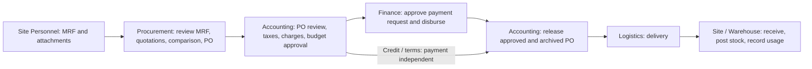

# HML ConstructSync — Current Application Context

> **Living document:** This is the canonical, implementation-aligned context for the application. Update this file in the same change whenever a major implementation changes the product scope, business workflow, domain model, permissions, routes, persistence, seeded walkthrough, architecture, or verification strategy. Do not record small visual polish, copy edits, or isolated bug fixes unless they change one of those areas.

**Last verified:** 2026-10-06
**Application version:** Prototype (`package.json` 0.1.0)
**State schema:** `DemoSnapshot` version 12

## Product in one paragraph

HML ConstructSync is a browser-local construction operations prototype, also deployed on Vercel for one-presenter company demonstrations. It demonstrates the linked journey from a Material Request Form (MRF) through Procurement review, supplier quotations and comparisons, Purchase Order (PO) preparation, Accounting approval and release, Finance payment approval/disbursement, Logistics delivery, and site receiving/usage. A fresh workspace starts empty. It uses simulated roles, browser `localStorage` for records, and IndexedDB for uploaded MRF, supplier quotation and optional Accounting evidence files. On Procurement approval, server routes archive a generated MRF PDF and its supporting PDF to a mapped Google Drive project folder. Finalized supplier quotations and Accounting-approved POs also archive to Drive. The server can parse quotations with Gemini when configured. Department email/password sign-in simulates access in the presenter browser; it has no server-enforced account authentication, shared record database, supplier portal or payment integration.

## Current product boundary

- Seven simulated roles share one workspace: Site Personnel, Procurement, Finance, Logistics, Accounting / Auditing, Management, and Administrator.
- Seven fixed department accounts use distinct passwords and Gmail-format identifiers without mailbox ownership or email delivery. Sign-in shows no account list, autofill or credential hints. The account menu displays the current email/department and Sign out; department changes require a new sign-in. Sessions remain until sign-out, while all accounts share the same browser-local records. These client-side checks simulate authorization rather than securing server APIs; Vercel deployment protection remains required.
- Project Manager is retired from app access and project assignments. The generic MRF Approved by signature remains document metadata; Procurement owns the app review.
- Site filtering changes dashboard and queue context without creating separate tenant data.
- All operational changes pass through typed domain commands and update one linked snapshot.
- The combined MRF support file is one required PDF of at most 50 MB, kept in the uploading browser's IndexedDB. It contains the hardcopy MRF, key plan, and work scope. Supplier quotation PDFs/images remain browser-local and receive Drive copies after finalization. Older MRF attachment references remain metadata for migration only.
- Drive credentials, the company root folder ID, and the upload-token key stay on the server. Administrator maps each project folder within that root. Vercel Drive routes require explicit enablement and Vercel Authentication for All Deployments, including production; simulated app roles do not secure them.
- Credential and project-folder setup is described in `docs/GOOGLE_DRIVE_SETUP.md`. The standard local dev and start scripts bind to loopback.
- The Gemini API key stays in the local Next.js server environment. Simulated roles do not secure the parsing endpoint; this integration is intended for local use only.
- For local parsing, copy `.env.example` to `.env.local`, set `GEMINI_API_KEY`, and restart `next dev`. MRF entry and quotation review both support manual entry without a key.
- External actions such as releasing a PO and recording payment are demonstrations only.
- The primary experience is desktop, while delivery receiving and inventory actions are intended to remain usable on mobile widths.

## Core business flow



For upfront purchases, Accounting releases only after full actual disbursement. Credit purchases may proceed without a payment request or Finance decision. Approval, payment approval, disbursement, release, receiving, stock posting and document review have separate states.

## Roles and implemented responsibilities

| Role | Main implemented responsibilities |
| --- | --- |
| Site Personnel | Create/save/submit MRFs with one support PDF; revise returned or reopened requests; confirm receiving; post accepted stock; record usage and stock adjustments. |
| Procurement | Review/return/reject MRFs and corrections, archive approved MRFs, review and archive supplier quotations, generate comparisons before POs, allocate awards and submit supplier-specific POs to Accounting. |
| Finance | Prioritize and approve/hold/return/reject payment requests; separately record actual disbursements for approved requests. Returns go to Accounting. |
| Logistics | Schedule delivery batches against the unscheduled balance of a released PO. |
| Accounting / Auditing | Review PO finances and payment arrangement, approve within budget or return to Procurement, archive approved POs, prepare payment requests and release eligible POs to Logistics. Review delivery evidence separately; make justified stock adjustments. |
| Management | Read cross-project reports and inspect exceptions; no operational approval commands. |
| Administrator | Add projects/sites, map and validate their Drive folders, inspect activity, retry archives, and reset browser workspace data through the unlinked maintenance page. |

The domain command layer in `src/domain/commands.ts` is the authority for permissions and transition validation. Hiding an action in the UI is not sufficient authorization.

## Workflow states and invariants

### Material requests

- States: `draft`, `submitted`, `returned`, `approved`, `rejected`.
- New MRFs, draft edits, returns, and full corrections use three steps: Request details, Materials, and Review & submit. Next validates the current step; Back and review Edit links retain entered values and files. The final step accepts the supporting PDF and shows a request summary before submission confirmation. Save draft permits incomplete information from every step and opens the saved record. Step progress is temporary; refresh restores explicitly saved work. PDF-only corrections open on the final step with request details read-only.
- Only Site Personnel can create/edit drafts, returned requests, or Procurement-reopened corrections. A reopened request with linked quotations or POs permits only a support-PDF change; an earlier reopened request permits full editing.
- New requests offer optional AI import in Step 1 through `POST /api/requests/extract`, using the server's existing `GEMINI_API_KEY` and `GEMINI_MODEL`. Import accepts one multipage PDF or up to 12 ordered JPG/PNG/WebP page photos of one MRF, up to 4 MiB total. Users preview/reorder sources, explicitly extract and apply results, and confirm replacement of edited form values. The project remains a manual selection; unreadable fields remain blank with warnings. Multiple MRFs and unrelated documents are rejected. Cancellation, timeout and errors preserve the entered form and allow manual entry.
- AI source bytes and Blob previews stay temporary in browser memory and are sent to Gemini only for extraction. They are never cached as attachments or archived to Drive. The combined supporting PDF remains a separate required upload in Step 3. AI-filled forms stay editable and require a fresh review checkbox before submission; detail/material edits clear confirmation. Drafts retain optional `aiAssisted` metadata but no review acknowledgement. Submission records `aiReviewedAt` and `aiReviewedBy`; the command layer enforces review for resumed AI drafts too. Existing MRFs remain manual and schema 12 stays compatible. This acknowledgement does not replace Procurement approval.
- Submission requires request details, at least one valid item, and one combined supporting PDF. The browser validates PDF type, signature, and 50 MB limit before storing it locally.
- General request information includes a manually entered, globally unique M.R.F No. and editable Request Date, plus Requested by, Approved by, Purchaser/Procurement Officer, and Finance Officer names. All six fields are required for submission but may be blank in a draft. Request Date is document metadata and may be in the future; system timestamps still drive activity and report filters.
- Each material carries its own date needed, purpose, delivery location, and remarks. Submission requires a name, unit, positive quantity, date, and location; purpose and remarks may be blank. Register and project summaries show the earliest material date.
- A submitted MRF or submitted correction can be reviewed by Procurement. Procurement approval requires a mapped project Drive folder. An insufficient PDF is returned to Site Personnel for replacement.
- The Procurement material cards display current on-hand site stock by exact material name and unit. Approval does not reserve or deduct stock.
- Form sections collapse without losing entered values; required sections start open and validation reveals the relevant field. Request material detail cards start closed with quantity/date summaries. Matching-offer links open the quotation comparison filtered by material ID.
- Return and rejection require a reason of at least five characters.
- Procurement approval records an `archive.pending` state and attempts Drive upload. The generated MRF PDF and supporting PDF are stored in separate subfolders under `<project>/<MRF number>/`. Supporting PDFs are uploaded in 3 MiB resumable chunks to fit Vercel's request limit. A failed upload leaves the MRF approved but Procurement paused; Procurement or Administrator retries manually. Completed archives retain numbered file pairs across reapprovals.
- New MRF PDFs and print previews retain the supplied NUMMER ETT branding and Letter landscape grid, including sixteen material slots, instructions, a blue supporting-file link and four signatory blocks. Generated values are centered and uppercase; request-date styling and attachment filename/link formatting are preserved. Formatting does not change stored input. Optional job-title inputs and printed titles are removed; existing title metadata is retained for compatibility. Extra rows or long cells continue on additional pages. Drive reserves the supporting file ID before generating the form, then fills that same file through resumable upload.
- Procurement may reopen an archived approved MRF. New Procurement actions pause during correction and archive pending states. Earlier quotations/POs stay linked. Procurement continues only after archive completion.
- Workflow handoffs and consequential decisions use a confirmation dialog; draft saves and routine edits do not. Successful actions use a brief global toast, while action failures remain visible in page banners and field corrections remain beside their inputs.

### Quotations and purchase orders

- Quotations begin as persistent drafts and may cover some MRF lines. They retain offered lines, discounts and charges, supplier details, commercial terms, source file IDs, and immutable finalized revisions. Older seeded quotations remain readable as legacy references without original file bytes.
- The quotation queue has one group per supplier; each group accepts up to 12 ordered PDF/JPG/PNG/WebP files, 20 MB per file and 45 MB combined. A single Extract with AI action processes ready groups separately with a visible per-group processing state. The general Enter manually action can attach a queued group's files, including after an extraction failure, or start a file-free draft that must receive supplier files before finalization. Draft review cards open on click; source documents open in a multi-file preview dialog.
- Gemini proposes extracted data and MRF matches only. Procurement checks the original, corrects pricing and supplier details, confirms each match and unit conversion, and explains any remaining discrepancy before finalization. Manual entry needs no API key, but newly finalized quotations require supplier PDF/image originals and a completed Drive archive before award. Unfinalized drafts can be deleted; finalized quotations remain immutable.
- Finalized quotations can be compared without a fixed quote count. Procurement may record a supplier selection reason; awards are staged and persist until PO generation. Only PHP quotations are awardable.
- Each PO stores its awarded MRF quantities and source quotation revision. Multiple POs may share one MRF; a material may be split across suppliers. Active PO and staged allocations cannot exceed requested MRF quantities or the supplier's quoted quantity; rejected POs release their allocation.
- Award generation creates one draft PO per supplier from the staged quantities. Procurement confirms each PO's line discounts and other charges. Draft and Accounting-returned POs may be edited; a draft using an older quote revision needs an explicit reason before finalizing. Submitted POs await Accounting; approved purchasing details are locked.
- Generated PO PDFs and print previews retain the supplied HML artwork and company header on Letter portrait pages. Vendor/bank/ship-to, reference and terms cells wrap and expand before material pagination; the complete linked MRF reference stays in its header field. The material grid keeps eleven rows when space permits, with measured row heights, VAT boxes and EWT/net totals. Ordinary shipping terms no longer generate a separate description-only form. Genuine long information or material overflow uses continuation pages. Editing screens retain their existing layout.
- New POs store per-order document fields: date, vendor address/contact/phone, bank and account details, ship-to details, requisitioner, payment terms, F.O.B. and shipping terms. Known quotation/project values prefill these fields. Date, vendor name, ship-to name/address, requisitioner and payment terms are required at finalization.
- New POs require an explicit review of VAT/NON-VAT status, inclusive/exclusive prices, an editable VAT rate (default 12%) and manual EWT goods/services amounts (zero allowed). The PO VAT setting replaces inherited quotation line taxes and tax adjustments. Included non-tax charges and discounts can be VAT taxable or exempt. Exclusive taxable inputs receive VAT once; inclusive and NON-VAT inputs receive no additional VAT. EWT reduces the gross purchase value to net supplier payable. Finance, commitments, payment caps and payment status use that net value. Existing POs without financial settings retain their original calculations.
- Draft printouts carry a preview watermark until Accounting approval. Previously archived PDFs remain unchanged.
- PO states: `draft`, `submitted`, `hold`, `returned`, `rejected`, `approved`, `released`.
- Procurement submits a PO to Accounting. Accounting can edit VAT/EWT settings and PO charges before approval; supplier/material/quantity changes return to Procurement.
- Accounting confirms `paymentMode` as `upfront` or `credit`. Approval validates reviewed finances, document essentials, confirmed adjustments and available project budget, then commits the unpaid PO value.
- Approved financial/purchasing details lock. Accounting archives the approved PO PDF and explicitly releases it to Logistics. Archive failures block release and offer retry.
- Upfront release requires full recorded Finance disbursement. Credit release needs no payment request, payment approval or disbursement.
- Payment requests are PO-linked records with `draft`, `submitted`, `hold`, `returned`, `rejected`, `approved`, `disbursed` states. Accounting prepares drafts/resubmissions; Finance reviews submitted/held requests. Return goes to Accounting.
- At most one open request exists per PO; rejected and disbursed requests remain in history. Positive partial amounts are allowed up to the unpaid balance; preparation defaults to that balance.
- Finance records actual disbursement only against an approved request, for exactly its approved amount, with method/reference/date. Duplicate and excess payments are blocked. Approval alone changes no payment, budget spend or delivery state.

### Bid comparison reports

- Procurement generates versioned Excel and PDF comparisons in the Compare step, before PO creation. An approved/archived MRF, mapped project folder and finalized/archived PHP quotations are required. PO creation and approval are independent of comparison generation. Partial coverage is allowed.
- Each supplier contributes one latest finalized PHP quotation, including suppliers without awards. Drafts and non-PHP bids are excluded. When multiple offers match one MRF material, Procurement explicitly chooses one alternative for that supplier/material before generation; report selections do not change awards.
- UNIT COST is the raw quoted price divided by its confirmed conversion factor. TOTAL COST is required MRF quantity multiplied by that converted price, rounded to cents. GRAND TOTAL sums these material totals and excludes discounts, taxes, freight and unmatched offers. Partial offered quantities are identified; missing prices remain blank, and incomplete supplier totals are labeled. These are comparison projections, not changes to quotation or PO financial calculations.
- New Excel exports contain one continuous Bid comparison worksheet with all suppliers and materials, no supporting sheets and no frozen-pane dividers. Formulas reference only the worksheet's quantity/unit-price inputs and carry cached results matching PDF amounts. Long text continues within the same worksheet; printing may span pages. Every archived quotation source file has its own clickable link row. Excel edits do not update application records or saved versions.
- Each report freezes project, MRF, bid, PO inputs and selected alternatives. New reports set comparisonRevision 3 and omit quotation-coverage rows/appendices; unquoted materials remain as blank prices in the comparison grid. Genuine content overflow still continues. Revision 2 retains its saved layout, and reports without a comparison revision retain the original eleven-slot layout, actual-offered/effective pricing, supporting worksheets and legacy retry behavior. Additive metadata keeps snapshot schema 12 compatible. Metadata and frozen inputs persist in the snapshot; XLSX and PDF bytes stay in IndexedDB, each with its own SHA-256 identity and generation/archive status. Existing saved and pending versions remain unchanged; obtain corrections through a new report version.
- Generation makes both downloads available and independently attempts their Drive archives beneath `<project>/<MRF number>/Bid Comparisons`. Dedicated encrypted tickets bind the artifact type; 3 MiB chunks support files up to 50 MB. A failure leaves the other artifact available and exposes a Procurement retry; retries reuse the report identity. All MRF viewers may download saved reports and open their Drive links, including after later corrections or Accounting returns.
- Workbook acknowledgements accept verified Google Drive or Google Sheets HTTPS links whose file ID matches the uploaded artifact. Archive jobs show global preparation, acknowledged upload progress, completion and persistent errors; retries reuse saved files and active jobs are deduplicated. Pending records after refresh offer retry without a running spinner.
- Missing local caches restore the exact archived bytes through a protected route validating project ancestry, artifact type and report tags. A hash mismatch is reported. Browser workspace clearing removes report records and cached bytes, while Drive copies remain.

### Budget

- The displayed provisional rule is `available = allocated - committed - spent`.
- Approved and released unpaid PO value is committed.
- A recorded payment moves that amount from commitment to spent, leaving available budget unchanged by the move itself.
- Draft, submitted, held, returned, and rejected POs are not commitments.
- This is prototype budget logic, not a formal accounting ledger.

### Delivery and inventory

- Only released POs can have delivery batches.
- Logistics can schedule expected quantities only within the unscheduled PO balance.
- Batch states: `expected`, `confirmed`, `posted`.
- Site Personnel confirms actual accepted quantities. A shortage or damaged/rejected amount requires an issue note.
- After confirmation or posting, Site Personnel may attach optional payment receipts, invoices, delivery receipts or other Accounting evidence. PDF/JPG/PNG/WebP uploads are limited to 20 MB each, 45 MB and 12 files per batch. File signatures and SHA-256 hashes are checked; metadata links every file to its batch and PO. Uploading evidence does not post stock or record payment.
- Accepted quantity cannot exceed the expected batch quantity or open PO balance.
- Posting uses accepted quantity, creates site-specific receipt movements, and is allowed once per batch.
- Editing accepted quantities at posting time requires a reason.
- Inventory is calculated from movements per site and per normalized material/unit pair: opening + receipts - usage +/- adjustments.
- Usage cannot create negative stock. Usage and adjustments require a reason; Accounting is a backup role for adjustments.

### Accounting

- Document review states are `Incomplete`, `Under Review`, `Complete`, and `Discrepancy`.
- Completing review requires both invoice and receipt references; a discrepancy requires a note.
- Payment status is derived independently as Unpaid, Partly Paid, or Paid.
- Finance disbursements must match an approved payment request and stay within the unpaid PO amount. Invoice/receipt completion is not required for upfront payment.
- Accounting PO review is available for submitted/held POs. Payment preparation, release review and document review are available after PO approval.
- The queue groups all related POs by MRF, including drafts, returned and rejected records. Search and project filtering retain those groups; submitted/held POs offer Accounting review; draft/returned POs await Procurement.
- Accounting records have an optional `documents` array compatible with schema 12. Evidence is available on both delivery and Accounting details, with local previews, protected Drive restoration, archive status and retries. New evidence changes a Complete review to Under Review without changing financial entries. Site Personnel, Accounting and Administrator may retry archives.
- Evidence archives use `<project>/<MRF>/Accounting Documents/<PO>/<batch>`, with file identity, hash and relationship tags. Encrypted upload tickets bind batch/PO/document IDs and file limits. Downloads validate project ancestry and relationship tags; a missing local cache restores only bytes matching the saved hash.

## Architecture and sources of truth

| Area | Current implementation |
| --- | --- |
| Framework | Next.js 16.3.6 App Router, React 19.2.8, TypeScript 5. |
| Route layer | `app/`; route files are thin adapters that render feature components. Dynamic route `params` and `searchParams` are awaited. |
| Feature screens | `src/features/` grouped by requests, purchasing, Finance, deliveries, inventory, Accounting, projects, suppliers, reports, dashboard, and admin. |
| Shared shell/UI | `src/components/`; `AppShell` owns navigation, account/site controls, theme, notifications and shared workspace chrome. Visible screens, metadata and feedback use production-style wording; the underlying prototype boundary remains documented here. |
| State access | `DemoProvider` in `src/app-state/` exposes repository state, signed-in command execution, account sessions, sign-in/sign-out, reset and transient notices. Normal UI cannot execute the setRole command directly. |
| Domain model | `src/domain/types.ts` defines records and statuses. |
| Mutations | `src/domain/commands.ts` is the single transition, permission, and validation boundary. |
| Derived data | `src/domain/pricing.ts` calculates quotation and PO totals; `src/domain/procurement.ts` validates quote review and revisions; `src/domain/selectors.ts` calculates budgets, delivery balances, payment state, and inventory. `src/domain/queues.ts` derives role tasks and dashboard metrics. |
| Persistence | `src/mock/repository.ts` owns local loading, saving, schema guards, recovery and explicit reset behavior. |
| Workspace baseline | `src/mock/fixtures/blank.ts` creates an empty browser workspace. `seed.ts` remains a test fixture only. |
| Styling | Global layers in `src/styles/` plus `app/globals.css`; `ui-direction.md` documents the visual direction. |
| Verification | Domain tests in `tests/demo.test.mjs` and `tests/procurement.test.mjs`; extraction tests in `tests/quote-extraction.test.mjs`; grouped quotation, award, Accounting approval and credit-release browser check in `scripts/quotation-smoke.mjs`; broader browser walkthrough in `scripts/browser-smoke.mjs`. |

Keep business rules out of page components where practical. New state transitions should be modeled as commands, new calculations as selectors, and durable records in the versioned snapshot.

## Persistence and recovery

- Current storage key: `hml-constructsync-demo-v12`.
- On first load, the repository creates an empty workspace if no saved state exists.
- Account session key: `hml-constructsync-session-v2`, storing only email and derived role. The former `hml-constructsync-demo-session-v1` is discarded without touching workspace records, requiring one new sign-in. Malformed or unknown account identities require sign-in. Retired Project Manager sessions require sign-in. A current v12 workspace saved with that selection loads as Site Personnel in memory without rewriting storage; the next valid sign-in saves the chosen role. Obsolete assignment fields and historical actor labels remain readable without granting access.
- Previous workflow records (v11 and earlier) require an explicit manual workspace clear. The app shows recovery and preserves saved records/keys until confirmation; it does not migrate old transactions into the new department flow. Pure legacy conversion helpers remain for historical regression tests and are not used by the active loader.
- MRF and quotation originals remain browser-local. Successful MRF archival also creates numbered Drive copies; clearing browser data removes local records/files but does not delete Drive files. The Gemini Files API is not used as permanent document storage.
- Malformed saved data enters an explicit recovery state instead of being silently overwritten.
- If storage is unavailable, the app continues with volatile in-tab state and displays a warning.
- Clear workspace restores the empty baseline, removes recognized legacy keys, and clears browser-local MRF and quotation files. Existing saved work remains until explicitly cleared.
- Old query-string links using `?view=&kind=&id=` redirect to current routes through `src/domain/legacy-links.ts`.

Any incompatible snapshot change requires a schema-version decision and a migration or an explicitly documented reset strategy.

## Route map

| Route | Purpose |
| --- | --- |
| `/` | Redirects legacy query links or defaults to `/dashboard`. |
| `/dashboard` | Role-specific metrics and derived task queue. |
| `/projects`, `/projects/[siteId]` | Project register and site workspace, including mapped Drive folder browsing and name search. |
| `/requests`, `/requests/new` | MRF register and creation. |
| `/requests/[id]`, `/requests/[id]/edit` | MRF detail/review, editable draft/return/correction form, Drive archive status, retry, and version links. |
| `/requests/[id]/quotes` | Guided grouped upload or manual quote entry, saved review and finalization, comparison, staged split awards, and PO generation. |
| `/suppliers` | Supplier directory derived from finalized quotations. |
| `/purchase-orders`, `/purchase-orders/[id]` | PO register and linked detail. |
| `/purchase-orders/[id]/edit` | Editable draft or returned PO. |
| `/finance`, `/finance/[poId]` | Finance payment request queue, decisions and actual disbursement. |
| `/deliveries`, `/deliveries/new` | Delivery tracker and batch scheduling. |
| `/deliveries/[id]` | Receiving confirmation and stock-posting flow. |
| `/inventory`, `/inventory/[siteId]/[materialId]` | Site inventory and material movement history. |
| `/accounting`, `/accounting/[poId]` | All POs grouped by MRF; PO/budget review, payment preparation, Logistics release and supporting documents. |
| `/reports` | Management cross-project reporting. |
| `/sign-in` | Email/password department access with no predefined account hints. |
| `/admin` | Project creation, Drive folder mapping and activity; no workspace reset control. |
| `/admin/maintenance` | Administrator-only confirmed workspace reset, reached directly without a navigation link. |
| `/api/drive/validate`, `/api/drive/archive`, `/api/drive/archive/chunk`, `/api/drive/files` | Protected project folder validation, resumable PDF archive, and project folder browsing/search. |
| `/api/documents/preview` | Generates the same MRF/PO PDFs used for archival for browser preview, download and printing. |
| `/api/bid-comparisons`, `/api/drive/bid-comparisons`, `/api/drive/bid-comparisons/chunk` | Server XLSX/PDF generation, protected report archival/download, and dedicated resumable uploads bound to artifact type. |
| `/api/drive/accounting-documents`, `/api/drive/accounting-documents/chunk` | Protected receipt/evidence archival, resumable upload/status, and verified downloads. |

All workspace routes are wrapped by `app/(workspace)/layout.tsx`, which applies the data gate and application shell.

## Empty workspace baseline

- A fresh browser starts with no projects, suppliers, MRFs, quotations, POs, deliveries, stock movements, payments, accounting records, or activity.
- Administrator adds a project with its name, location and allocated budget. Site Personnel can then create the first MRF.
- Suppliers enter the directory when Procurement finalizes a quotation.
- The historical cement transaction remains in `src/mock/fixtures/seed.ts` for automated test fixtures only. It is never loaded for a new or cleared workspace.

Department account credentials and reset instructions: [PRESENTER_ACCESS.md](PRESENTER_ACCESS.md). Architecture decision: [protected department walkthrough](adr/0001-protected-department-walkthrough.md).

## Verification baseline

Run the following after changes that affect behavior or architecture:

```bash
npm test
npm run lint
npx tsc --noEmit
npm run build
```

With the development server running, use `node scripts/browser-smoke.mjs` for the broader linked workflow, persistence, legacy links, and UI checks at 320–1440 px in light and dark themes. UI regressions cover short-screen sign-in scrolling, long request references, account-dialog focus containment and restoration, text/focus contrast, mobile control sizes, and document-preview bounds. Use `node scripts/quotation-smoke.mjs http://localhost:3100` with a production server on port 3100 for grouped quotation review, saved awards, split POs, Accounting approval and credit release, and print status.

The domain test suite currently protects these high-value behaviors:

- Seeded purchasing, delivery, inventory, and budget consistency.
- MRF permission/review rules and ID preservation after return/resubmission.
- Seven unique account passwords, normalized emails, invalid credential/session rejection, remembered sessions, password-free session storage and legacy session invalidation without record loss. Browser handoffs sign out and back in, verify product copy/metadata, and check maintenance visibility and access.
- The browser walkthrough covers MRF step validation, navigation and file retention, incomplete draft saving/reopening, final confirmation, returned-request resubmission, PDF-only corrections, and responsive step layouts.
- MRF AI tests cover source limits/signatures, same-origin requests, ordered page uploads, malformed/unrelated/multiple-request results, provider failures, blank unreadable values and mandatory review metadata. The browser uses mocked extraction responses to verify preview, cancellation, retry, explicit replacement, manual editing, separate attachments and fresh review after draft reopening. Live OCR accuracy remains dependent on the configured model and document quality.
- Single stock posting, outstanding quantities, site isolation, and nonnegative inventory.
- Payment movement from commitment to spent without double-reducing available budget.
- Prior workflow reset guard, explicit clearing, current payment/release persistence and malformed-data recovery. Historical migration helper tests remain separate from active loading.
- Quote review/finalization, staged split award caps, charge confirmation, quote revisions, and version-4 migration.
- Legacy URL routing.
- Bid report readiness, immutable versions, v9 migration, workbook formulas and cached totals, quotation revisions, partial awards, and dedicated XLSX upload validation. The quotation browser walkthrough also verifies Drive failure/retry, exact cache recovery, report persistence, and Finance downloads.
- Comparison revision 2 protects raw converted unit prices, required-quantity projections, explicit alternatives, incomplete coverage, dynamic supplier counts, single-sheet formulas, complete long text, clickable quotation links, and legacy report dispatch. PDF regressions verify complete PO references, ordinary shipping terms on one page, MRF capitalization, attachment casing and preserved input. Browser verification exercises alternative selection before generation.

## Known assumptions and non-goals

- Main department handoffs follow the client-approved flow. Detailed departmental fields and policies will be supplied later.
- Actual supplier transfers remain simulated references entered by Finance.
- The budget commitment calculation is a display rule pending client validation.
- Formal purchase closure is not modeled.
- Formal tax/VAT/EWT accounting, accruals, bank balances, detailed ledgers, real notifications, shared record storage, email, and Drive quotation import are out of scope.
- The year embedded in generated PO references is currently fixed to `2026`.
- The repository is deliberately local-first and single-browser; concurrent multi-user behavior is not modeled.

## Maintenance contract

Update this file in the same implementation whenever a change affects any of the following:

1. Product scope, terminology, or a working assumption.
2. A role, permission, handoff, status, validation rule, or business invariant.
3. A domain record, command, selector, snapshot version, storage key, or migration.
4. A user-facing route, major feature area, or architectural ownership boundary.
5. Seeded records or the canonical walkthrough and its expected figures.
6. Required verification commands or protected end-to-end behavior.

When updating it:

- Describe the implemented behavior in present tense; keep future plans in **Known assumptions and non-goals**.
- Reconcile related sections rather than appending contradictory notes.
- Update **Last verified** and add one concise entry to the change log.
- Confirm statements against the implementation, especially `types.ts`, `commands.ts`, `selectors.ts`, the repository, route files, and tests.
- Keep detailed design history in version control; this file should remain a compact snapshot of the current system.

## Context change log

| Date | Context change |
| --- | --- |
| 2026-10-06 | Added fixed department email/password accounts, removed sign-in hints and role switching, introduced v2 remembered account sessions, hid reset behind an Administrator maintenance route and removed visible prototype/storage labels. |
| 2026-10-05 | Added optional temporary MRF PDF/photo extraction with editable results, manual project selection, separate supporting attachments and mandatory human review on AI-assisted submission. |
| 2026-10-05 | Removed Project Manager access and project assignments; retained generic MRF signatures and compatibility with saved v12 selections and historical actors. |
| 2026-10-05 | Adopted Procurement MRF review, Accounting PO/budget approval and release, separate Finance payment requests/disbursement, upfront and credit paths, comparison before PO, and schema 12 with explicit old-workspace reset. |
| 2026-10-02 | Added a three-step MRF creation and revision flow with per-step validation, review summary, incomplete draft saves, and a direct final-step path for PDF-only corrections; integrated with main's company document templates and snapshot version 11. |
| 2026-09-30 | Corrected MRF capitalization/alignment and removed job titles; made PO fields resize; added comparison revision 2 with explicit alternatives, required-quantity material totals, actual supplier columns and one continuous Excel sheet, preserving every earlier report version. |
| 2026-09-30 | Added immutable versioned Excel bid comparisons with three formula-based sheets, PO readiness gates, IndexedDB file caches, resumable Drive archival, exact download recovery, and v9-to-v10 migration. |
| 2026-09-30 | Replaced generated MRF/PO/comparison formats with supplied company forms; added matching PDF previews, comparison PDF/Excel artifacts, per-PO document fields, reviewed VAT/manual EWT/net financial semantics, linked MRF support uploads, continuation pages, and schema v11 migration preserving existing records. |
| 2026-09-24 | Created the canonical application context from the implemented routes, domain model, command rules, persistence layer, seed data, and tests. |
| 2026-09-25 | Moved request detail fields to each material, added general information names, and migrated saved snapshots to version 3. |
| 2026-09-25 | Added browser-local supplier quotation files, Gemini extraction review, material-level comparison, split supplier awards, and version 4 data migration. |
| 2026-09-27 | Added grouped supplier quote drafts and revisions, guided review and finalization, persistent split allocations, supplier PO charge confirmation, version 5 migration, and updated browser verification. |
| 2026-09-28 | Changed new and cleared workspaces to start empty, added Administrator project creation and clear action, and added first-MRF setup guidance. |
| 2026-09-28 | Removed category and supplier setup from Admin, added reopenable MRF scope and signed files, optional material purpose, mixed-file supplier groups, batch AI action, draft deletion, decision dialogs, and version 6 migration. |
| 2026-09-28 | Added manual globally unique M.R.F numbers and editable Request Dates with version 7 migration, and streamlined quotation upload, review cards, and document preview. |
| 2026-09-29 | Added required combined MRF PDF, project Drive folder mapping, post-approval PDF archiving with manual retry and version history, project file browsing, correction workflow, and version 8 migration. |
| 2026-09-29 | Adapted Drive archiving for a protected one-presenter Vercel deployment with explicit enablement, encrypted resumable upload tickets, 3 MiB chunks, and upload-status recovery. |
