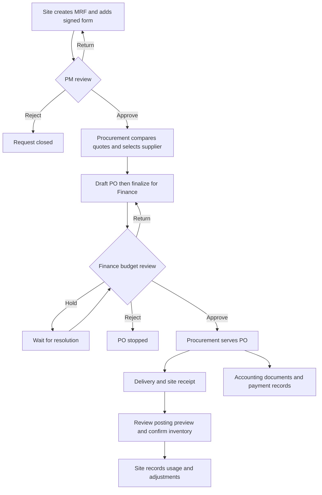
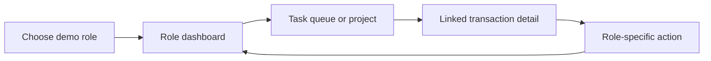

# HML BuildSync — UI Prototype Brief for Codex

> **Task:** Build a runnable, polished, interactive prototype of HML BuildSync. Implement the flows below in the project where this brief is provided. Inspect the existing project first and follow its conventions. If the project is empty, choose a sensible web app setup. Complete the implementation, run it, and verify the main walkthrough; do not stop after producing a plan or static mockups.

## 1. Prototype boundary

This is a **business process and UI demonstration**, not a production deployment. Use believable seeded data and browser `localStorage` for persistence. No database, backend, API, Supabase, Google authentication, OAuth, sign-in form, live Google Drive, payment gateway, actual bank transfer, email delivery, supplier portal, or server-side file storage. A user should be able to launch the app and explore it immediately.

Replace the proposed sign-in screen with a **demo role selector**. Keep a visible role switcher throughout the app so a presenter can act as Site Personnel, Project Manager, Procurement, Finance, Logistics, Accounting/Auditing, Management, or Administrator without credentials. This role switch is a simulation of permissions, not security. Start with seeded data on first launch; include a prominent **Reset demo data** action with confirmation. Actions should update linked records and survive a refresh through `localStorage`.

Prioritize the complete, believable path from a site request to stock on hand over extra features. Primary actions should work. Do not show dead buttons as if they are functional. Use clear "Demo" labels for simulated external steps such as serving a PO or recording a payment.

## 2. Business story

HML is a construction company with multiple projects/sites. A site requests materials; its Project Manager reviews the need; Procurement collects and compares supplier quotations, selects a supplier, and prepares a Purchase Order (PO); Procurement **finalizes** the PO to send it to Finance for budget review. Finance approval permits the PO to be **served to the supplier**. Delivery can be full or partial. Site Personnel verify actual accepted quantities, review an inventory posting preview, then confirm the stock increase for that site. They later record consumption and corrections. Accounting/Auditing tracks invoices, receipts, payment references, and discrepancies alongside delivery; payment timing depends on supplier terms.

**Terminology:** An MRF is a Material Request Form. `Finalized` means Procurement has finished the PO and submitted it to Finance; it does **not** mean budget approval. `Finance approved` permits serving the PO; it does **not** mean paid or delivered. Keep request, PO/Finance, delivery, payment/documents, and inventory posting statuses separate on the same linked transaction.

## 3. Roles and the first thing each sees

| Demo role | Dashboard / queue | Main actions |
| --- | --- | --- |
| Site Personnel | Own MRFs, returned requests, expected deliveries, low stock | Create/revise MRF, attach mock document references, confirm accepted quantities, review/post stock, record usage and justified adjustments |
| Project Manager | Submitted MRFs for assigned sites, on-hand stock, overdue needs | Approve, return with reason, or reject with reason; monitor linked purchases |
| Procurement | Approved MRFs needing quotations, draft/returned POs, approved POs to serve | Compare quotations, select supplier with rationale, create/edit/finalize PO, mark served |
| Finance | Finalized POs by project, age, amount, priority, available budget | Set priority and approve, hold, return, or reject with reason |
| Delivery / Logistics* | Served POs, schedules, partial and delayed deliveries | Schedule delivery, record an expected batch or delay, track outstanding quantity |
| Accounting / Auditing* | Missing invoices/receipts, payment status, discrepancies | Record invoice/receipt/payment reference, mark document review complete or flag issue; backup for authorized stock correction |
| Management | Cross-project spending, requests, delivery delays, stock and exceptions | Drill into linked records and inspect summary reports; no operational approval |
| Administrator | Demo users, sites, reference data, activity history | Review demo settings and assignments; reset demo data |

*Logistics and Accounting details are **working assumptions**, subject to later client validation. The UI should make these sections easy to revise.

The app header shows the active role and site context. Dashboards show real counts derived from current demo state, a task list, aging/waiting time, and links to the record requiring action. Role switching changes available actions and dashboard content but preserves the same transaction data.

## 4. Information architecture and screen expectations

Design **21 logical screen types** from the planning guide. These do not require 21 separate routes: related create/edit/details views may be one page with tabs or a drawer. Desktop is the primary presentation size; receiving and inventory actions must also work comfortably on a phone.

| # | Screen / area | What to show and what should work |
| --- | --- | --- |
| 01 | Demo entry / role selector | Pick a role instantly; no credentials. Explain that activity is locally simulated. |
| 02 | Role dashboard | Role-specific totals, tasks, aging, alerts, site filter, and direct record links. |
| 03 | Projects / sites | Site cards or table with budget, pending requests, deliveries, and stock flags. |
| 04 | Project workspace | One site overview with tabs for MRFs, POs, deliveries, budget, and inventory. |
| 05 | Material request list | Search/filter by site, status, category, needed date; create or open MRF. |
| 06 | MRF form | Site, scope/category, items (description, unit, quantity), needed date, purpose, location, remarks, signed-form/Key Plan references; save draft, submit, or revise a return. |
| 07 | MRF details / PM review | Request, documents, stock context, decision reason, status, related PO and activity timeline; PM actions only when submitted. |
| 08 | Quotation comparison | At least two suppliers side by side: item prices and totals, availability, lead time, payment terms, quote references. Procurement chooses and writes a selection reason. Cheapest is highlighted for comparison, never auto-selected. |
| 09 | Supplier directory | Supplier name, location, contact, basic accreditation reference, and quotation history. |
| 10 | PO list | PO number, linked MRF, supplier, site, amount, Finance state, served state, and delivery progress. |
| 11 | PO editor / detail | Prefill from selected quote and MRF; show line items, totals, terms, site, supplier, notes, timeline and print-friendly PO preview. Draft → Finalize for Finance; after approval, mark served. |
| 12 | Finance queue | Finalized POs sorted/filterable by site, priority, amount, and waiting time. |
| 13 | Budget / PO review | PO beside allocated, committed, spent, available budget; decision buttons with reason for hold/return/reject and priority control. |
| 14 | Delivery tracker | Served POs, scheduled date, ordered/accepted/outstanding quantities, partial/delay flags. |
| 15 | Delivery / receiving | Enter a batch and evidence reference; Site confirms actual accepted quantity and any shortage/damage. Show an editable posting preview, require reason for changes, then post once. |
| 16 | Site inventory | Stock on hand by material and site, low-stock indication, last update. |
| 17 | Material detail / movements | Dated receipt, usage and adjustment entries with actor and reason; usage reduces that site's stock. |
| 18 | Accounting queue | Purchases needing documents or showing a mismatch, with separate payment and documentation badges. |
| 19 | Accounting record | Linked PO, invoices, receipt/payment references, payment method/amount/date, delivery evidence, discrepancy notes and review completion. |
| 20 | Management reports | Filter by project/date and inspect requests, purchasing, budget, delivery balances, document gaps and stock. Simple charts/cards are fine if derived from demo data. |
| 21 | Administration | Demo role/site assignments, reference categories, activity history, and reset control. |

Navigation should be understandable from either a role's task queue or a project workspace. Record detail pages need a consistent header: project, reference, distinct status badges, current owner, next step; tabs/sections for items, documents, linked records and an activity timeline. Keep back navigation and site context visible. A notification tray can link to pending/returned items; notifications are local state, not real messages.

## 5. Rules that make the prototype feel real

| Area | Expected behavior |
| --- | --- |
| MRF | `Draft → Submitted → Approved`, or `Returned → Resubmitted`, or `Rejected`. Return shows a reason and enables Site to edit; rejection stops the request. PM sees site stock during review. |
| Quotes | Only an approved MRF can be quoted. Compare at least two seeded suppliers or allow Procurement to add quotes. Require a selection reason. |
| PO | One selected supplier and PO per MRF is enough for this prototype. `Draft → Finalized for Finance → Finance Approved → Served`. A Finance return reopens PO editing and requires re-finalization; hold suspends the decision; rejection stops the PO. Preserve the review reason and history. |
| Budget | Show `available = allocated − outstanding approved commitment − paid/spent`. On Finance approval, the unpaid PO value becomes a commitment; when a payment is recorded, that amount moves from commitment to spent, so it is not double counted. A rejected/returned PO is not committed. This is a **provisional display rule**, not bank integration or formal accounting. |
| Delivery | Only a served PO can be scheduled/received. Track each batch against each PO item. `Outstanding = ordered − cumulative accepted`. A partial batch leaves the remainder open. Damaged/rejected quantity does not enter inventory. Never receive more than outstanding. |
| Stock posting | Use the **accepted** amount from a confirmed delivery, not the ordered amount. Show site, item, unit, accepted quantity and proposed stock increase before confirmation. A correction needs a reason and must be reflected in confirmed receipt quantities. Post a batch once only; later changes are separate, reasoned adjustments. |
| Site inventory | Site Personnel record material usage and authorized adjustments; no negative stock. Stock is per site, not a company-wide pool. `On hand = opening + posted accepted deliveries − usage ± adjustments`. Accounting is a backup for justified correction. |
| Accounting* | HML pays the supplier under the recorded terms, possibly before or after delivery. Record cash/bank/check/other as **simulated** references. Payment status (`Unpaid/Partly Paid/Paid`) and document status (`Incomplete/Under Review/Complete/Discrepancy`) are separate from delivery. Do not infer paid from delivered. |
| History | Every important state change shows actor, time, action and reason when relevant. Use separate badges for MRF, PO/Finance, delivery, payment, documents and stock posting. |

Do not silently edit a served PO. For the demo, lock its purchasing details after serving and explain that changes require a separate review process. Avoid implementing complex tax, EWT, VAT, accruals, bank balances or a full accounting ledger. A clear PO line-item subtotal and total is sufficient.

## 6. Seeded demo data

Create at least **two sites/projects**, **three suppliers**, and **eight MRFs** spanning draft/submitted/returned/approved/rejected, with at least four approved requests supporting POs in draft/finalized/approved/served stages. Include a Finance hold or return, a scheduled delivery, a partial delivery, a documentation gap, and stock movements. Give every record a readable unique reference, sensible dates and a linked site. Seed attachment **metadata** with meaningful names (for example, signed MRF, Key Plan, supplier quotation, delivery receipt). Display a sample preview or metadata card rather than a broken external link. If the UI accepts a new file, make it explicit that only its name/type are stored for the demo; do not put document bytes into `localStorage`.

Include a coherent sample transaction that can be inspected immediately: **Site A requests 100 bags of cement**; a selected quote prices it at a consistent unit cost; its PO has Finance approval and is served. One accepted batch of **60 bags** is posted, leaving **40 outstanding**. Site records **30 bags used**, leaving **30 bags on hand** before the second delivery if opening stock is zero. A second accepted/postable batch of **40** should take stock to **70** if posted. The dashboard, delivery tracker, inventory, budget and accounting views must all agree as actions happen. Choose project budget figures large enough to cover its approved commitments.

Offer an easy way to demonstrate the full journey from a **new MRF** using the role switcher, in addition to exploring pre-seeded records. New transactions should retain references across every step without a refresh. Provide empty states when filters have no results.

## 7. Visual and interaction direction

Make this look like a credible construction operations product: calm neutral base, strong headings, restrained blue/teal accents, clear status colors with text labels, spacious tables and readable forms. Use consistent cards, timeline, breadcrumbs and status chips. Prioritize information hierarchy over decorative graphics. Lists should have meaningful search, filters and sorting. Confirm destructive/reject/post actions; show immediate feedback for saves and transitions; provide validation messages beside fields. Make keyboard navigation and contrast reasonable. On small screens, turn wide tables into cards or horizontal sections rather than shrinking text beyond readability.

Use clear context-specific action labels such as **Submit MRF**, **Return with reason**, **Finalize for Finance**, **Approve budget**, **Mark PO served**, **Confirm received quantities**, **Post to site stock**, and **Record usage**. Show the next responsible role after each action. A visible "Prototype / mock data" indicator prevents users from mistaking simulated external events for actual purchases or payments.

## 8. Verification and completion

Finish with a functioning app, not only a plan. Check at least this walkthrough in the running prototype:

1. Choose Site Personnel, submit a new MRF, and confirm it appears in PM's queue after switching roles.
2. PM returns it with a reason; Site revises and resubmits; PM approves.
3. Procurement adds/compares quotes, chooses a supplier with reason, drafts and finalizes a PO.
4. Finance returns or holds it with a reason; Procurement revises/re-finalizes; Finance approves; Procurement marks it served.
5. Logistics schedules a delivery; Site accepts a partial quantity, reviews the preview, posts it once, and sees remaining quantity open.
6. Site records usage; Accounting records a document/payment reference; Management sees updated cross-project counts.
7. Refresh: state persists. Reset demo data: seeded state and counts return.

Keep any explanatory README brief: how to run the app, how role switching and reset work, and which areas are assumptions. If there is already a visual guide or brand assets in the project, follow them where they do not conflict with this prototype brief.

## Working assumptions to confirm with the client later

Logistics ownership and exact handoffs; who records and authorizes payment; Accounting's document and stock-correction authority; the budget commitment rule; and formal purchase closure. For now, implement the coherent demo behavior described above and label it provisional where relevant. Do not block the prototype waiting for these answers.
